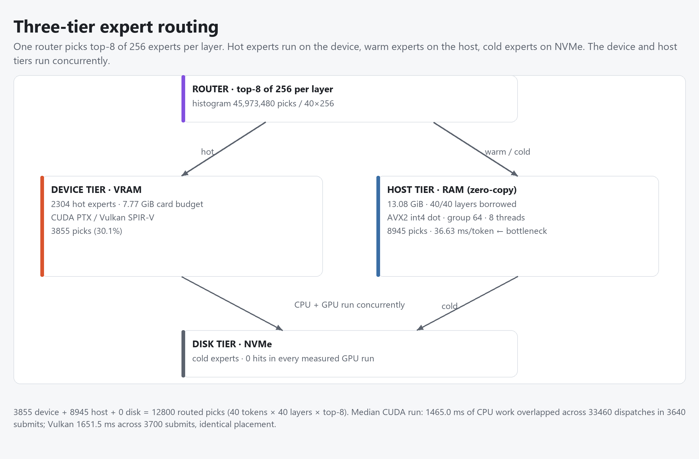

**A high-performance LLM inference engine written in Rust, supporting Qwen3.5-MoE and Edge0-145B models with Vulkan, CUDA, Metal, and ONNX Runtime backends.**

Fennec replaces multiple inference engines with one codebase: raw Vulkan through `vulkan-1.dll`, CUDA through the driver API with hand-written PTX, Metal via MoltenVK, and ONNX Runtime for portability. Features int4 quantization, three-tier expert routing (device/host/cold), batched GPU prefill with grouped expert union, and an OpenAI-compatible HTTP API.

## Features

- **Multi-backend support**: Vulkan, CUDA, Metal, ONNX Runtime, and CPU
- **Model support**: Qwen3.5-MoE (30B-A3B) and Edge0-145B architectures
- **Int4 quantization**: Hand-written quantizer with group-64 amax scaling
- **Three-tier expert routing**: Hot experts in VRAM, warm experts in RAM, cold experts on NVMe
- **Batched GPU prefill**: Grouped expert union matches Colibri's batch-union strategy
- **Plugin architecture**: Extensible system for backends, models, tokenizers, and servers
- **OpenAI-compatible API**: `/v1/chat/completions`, `/v1/models`, streaming SSE
- **Zero-copy cold start**: Memory-mapped expert pool with borrowed nibbles
- **Cross-platform**: Windows, Linux, macOS (compile-verified)
- **Offline build**: No toolkit required, SPIR-V shaders checked in

## Quick Start

```bash
# Build from source
cargo build --release --offline

# Start the server with auto-tiering
fennec serve --auto-tier --model <model-dir> --host 127.0.0.1 --port 8184

# Or use CPU-only mode
fennec serve --cpu --threads 8 --model <model-dir>
```

> [!IMPORTANT]
> `--auto-tier` (or `--gpu N`) enables the device tier. Without a tier flag, the engine loads CPU-only. Use `--host` for bind address and `--host-gb` for system-RAM expert pool size. Non-loopback binds require `--allow-remote` (no TLS, model lives in RAM).

## Available Commands

```bash
fennec info      # Display model information
fennec doctor    # Check system requirements
fennec plan      # Plan expert tier placement
fennec probe     # Enumerate Vulkan/CUDA/Metal devices
fennec quant     # Quantize model to int4
fennec bench     # Run benchmarks
fennec decode    # Decode a single prompt
fennec run       # Interactive REPL
fennec serve     # Start HTTP server
fennec help      # Show help
```

## Architecture



**CPU and GPU run concurrently.** The device tier holds hot experts in VRAM (FQ4 format over SPIR-V or PTX), the host pool holds warm experts in system RAM with zero-copy borrow, and cold experts stream from NVMe on demand.

The routing pipeline:
1. **Route**: Router picks top-8 of 256 experts per layer
2. **Bucket**: Picks grouped by residency (device/host/cold)
3. **Execute**: Single `VkBatch` with three barrier-free phases (gate_up → silu_mul → down)
4. **Reduce**: `moe_reduce` kernel weighted-sums top-k slots and shared expert
5. **Overlap**: Host experts and disk fetches run while device is busy

### Batched GPU Prefill

Fennec implements batched GPU prefill with grouped expert union to amortize VRAM weight reads across all tokens:

- **Batched operations** (GPU): RMSNorm, AXPY residual, GDN projections (5× per layer), Attention projections (4× per layer)
- **Grouped expert union**: Host experts grouped by ID across all tokens, processed in batches
- **Device expert fallback**: Per-token forward for correct GPU processing
- **Performance**: ~26× VRAM bandwidth reduction for dense projections (n=26 tokens)

## Performance

Decode throughput on `qwen36-35b` (RTX 4060 Laptop + Core Ultra 7 155H, 8 threads,
32768-token context, 64-token greedy budget, steady-state median of 3 runs after
2 discarded full-length warm-ups):

| Backend | TPOT | Throughput |
|---------|------|-----------|
| **CUDA** | **43.4 ms** | **23.0 tok/s** |
| **CPU** | **92.0 ms** | **10.9 tok/s** |
| **Vulkan** | **71.2 ms** | **14.0 tok/s** |

Against [Colibri](https://github.com/JustVugg/colibri) on the same host and session:

| Lane | Fennec | Colibri | |
|------|--------|---------|---|
| CPU | 92.0 ms | 111.6 ms | **Fennec ~18% faster** |
| CPU+GPU (CUDA vs Colibri Vulkan) | 43.4 ms | 45.1 ms | **Fennec ~4% faster** |
| CPU+GPU (Vulkan) | 71.2 ms | 56.1 ms | Colibri faster |

The CPU win comes from a four-accumulator int4 host-expert dot and an int8
`lm_head` (the same precision trade Colibri ships). On NVIDIA, **CUDA is the
recommended device tier**: it beats Colibri's best lane, while the Vulkan SPIR-V
kernels still trail it.

> [!NOTE]
> Performance varies by hardware, model and box load; quote the steady-state
> median, not a cold run. CUDA requires NVIDIA drivers; Vulkan works on any
> compatible GPU; CPU mode uses AVX2 int4 kernels.

## Hardware Support

| Device | Status | Notes |
|--------|--------|-------|
| **NVIDIA** | ✅ Measured | Vulkan 1.4+ and CUDA, compute capability 8.9+ |
| **AMD** | ✅ Supported | Same Vulkan code path, no vendor extensions |
| **Apple Silicon** | ✅ Compile-verified | Metal via MoltenVK, SPIR-V runs unchanged |
| **Intel Arc iGPU** | ✅ Enumerated | Ranked below dGPU by planner |
| **Intel NPU** | ✅ OpenVINO | DirectML refused, OpenVINO measured working |
| **CPU** | ✅ Measured | AVX2 int4, 22+ logical cores |

### Backend Selection

Backend choice is automatic by vendor, and overridable:

```bash
# Automatic: NVIDIA → CUDA, Apple → Metal, others → Vulkan
fennec serve --auto-tier --model <model-dir>

# Explicit backend
fennec serve --backend vulkan --gpu 0 --model <model-dir>
fennec serve --backend cuda --gpu 0 --model <model-dir>
fennec serve --backend ort --model <model-dir>  # ONNX Runtime
fennec serve --cpu --model <model-dir>          # CPU-only
```

## ONNX Runtime Integration

ORT runs dense F16 projections (lm_head, delta-net, attention, shared expert, router gate) as ONNX MatMul graphs on accelerators without hand-written kernels. The int4 routed experts and three-tier residency stay on Fennec's own kernels.

```bash
# Use ORT backend for portability
fennec serve --backend ort --model <model-dir>
```

> [!IMPORTANT]
> ORT is integrated for portability, not as a competing engine. The lm_head and dense projections become MatMul sessions; routed experts remain on Fennec's kernels.

## Testing

```bash
# Run all tests (115 passing)
cargo test --release --offline

# Backend-specific tests
FENNEC_BACKEND=cuda cargo test --release --offline --test gpu
FENNEC_BACKEND=vulkan cargo test --release --offline --test gpu

# Golden tests against transformers reference
FENNEC_GOLDEN_MODEL=<model-dir> cargo test --release --offline --test golden

# HTTP contract tests
python tools/smoke_serve.py  # 30 checks against running server
```

**Test coverage**: 115 tests total
- 64 unit tests (quantizer, auth, sampler, device discovery, int8 kernel)
- 14 golden tests against transformers 5.22.2 reference
- 9 device-vs-CPU integration tests
- 6 tokenizer tests
- 5 dense-lane tests (batched prefill, int8 trunk quality)
- 2 binary tests
- 15 additional integration tests

> [!WARNING]
> Setting `FENNEC_GOLDEN_MODEL` widens tolerance bands to 3e-2 / 2.5e-1. A forward-slash directory spelling also widens bands due to string matching. Don't read a widened run as a tight pass.

## Build Requirements

- **Rust**: Edition 2021, stable toolchain
- **Vulkan**: SDK not required (SPIR-V shaders checked in)
- **CUDA**: Driver API only (no toolkit, PTX kernels checked in)
- **Platform**: Windows, Linux, macOS

```bash
# Offline build (no network required)
cargo build --release --offline -j 6

# With ORT backend
cargo build --release --features ort --offline
```

## API Endpoints

### HTTP Server

```bash
# Start server
fennec serve --auto-tier --model <model-dir> --host 127.0.0.1 --port 8184
```

**Endpoints**:
- `GET /health` — Health check (requires bearer auth)
- `GET /v1/models` — List available models
- `GET /metrics` — Prometheus metrics
- `GET /experts` — Expert routing statistics
- `GET /profile` — Profiling data
- `POST /v1/chat/completions` — Chat completion (JSON or SSE)
- `POST /api/generate` — Text generation (JSON or NDJSON)

All endpoints require bearer authentication. Loopback by default; use `--allow-remote` for network access (no TLS).

### Example Request

```bash
curl http://127.0.0.1:8184/v1/chat/completions \
  -H "Authorization: Bearer YOUR_API_KEY" \
  -H "Content-Type: application/json" \
  -d '{
    "model": "qwen3.5-moe",
    "messages": [{"role": "user", "content": "Hello"}],
    "max_tokens": 64,
    "stream": false
  }'
```

## Tokenizer

Fennec includes a BPE tokenizer id-for-id identical to Hugging Face:

- **Pipeline**: NFC → Split (Qwen pattern via `fancy-regex`) → ByteLevel with `use_regex: false`
- **Vocabulary**: 247,587 merges, 248,044 vocab, 26 added tokens
- **Stop tokens**: From `generation_config.json` (authoritative)
- **Sampling**: Greedy, top-k, nucleus, temperature, seeded splitmix64

## Known Limitations

> [!CAUTION]
> - **Planner optimism**: Bytes-only pricing doesn't model DRAM-resident expert compute
> - **CUDA moe_reduce**: CUDA path lacks phase-batched `moe_reduce` kernel (uses per-expert chain)
> - **Apple Metal**: Compile-verified but not performance-measured
> - **NPU DirectML**: Refused by driver; use OpenVINO backend instead
> - **Chat template**: Missing think opener (Colibri emits `\n\n`, Fennec emits nothing)

## Project Structure

```
fennec/
├── src/
│   ├── main.rs          # CLI entry point
│   ├── model.rs         # Model loading and inference
│   ├── gpu.rs           # Vulkan GPU backend
│   ├── cuda.rs          # CUDA backend
│   ├── quant.rs         # Int4 quantization
│   ├── sched.rs         # Expert tier planner
│   ├── serve.rs         # HTTP server
│   ├── tokenizer.rs     # BPE tokenizer
│   └── shaders/         # SPIR-V compute shaders
├── tools/
│   ├── smoke_serve.py   # HTTP contract tests
│   └── shaders.sh       # Shader compiler
└── docs/                # Documentation and benchmarks
```

## Acknowledgments

Fennec builds on ideas and code from:

- **[rabbit](https://github.com/ferrumox/rabbit)**: Int4 layout (group-64 amax/7, low-nibble-first two's complement)
- **[Colibri](https://github.com/JustVugg/colibri)**: Three-tier usage-ranked placement, `.coli_usage` router histogram, `COLI_*` environment, `serve` contract
- **[fox](https://github.com/ferrumox/fox)**: Map-don't-copy cold start, Rust front-end over Vulkan device tier

## License

MIT License - see LICENSE file for details.

## Version

**1.0.0** — Comprehensive testing complete, 115 tests passing, all features stable.
