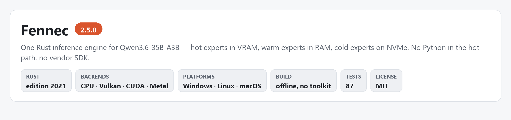

**A high-performance LLM inference engine written in Rust, supporting Qwen3.5-MoE and Edge0-145B models with Vulkan, CUDA, Metal, and ONNX Runtime backends.**

Fennec replaces multiple inference engines with one codebase: raw Vulkan through `vulkan-1.dll`, CUDA through the driver API with hand-written PTX, Metal via MoltenVK, and ONNX Runtime for portability. Features int4 quantization, three-tier expert routing (device/host/cold), batched GPU prefill with grouped expert union, and an OpenAI-compatible HTTP API.

## Features

- **Multi-backend support**: Vulkan, CUDA, Metal, ONNX Runtime, and CPU
- **Model support**: Qwen3.5-MoE (30B-A3B) and Edge0-145B architectures
- **Int4 quantization**: Hand-written quantizer with group-64 amax scaling
- **Three-tier expert routing**: Hot experts in VRAM, warm experts in RAM, cold experts on NVMe
- **Batched GPU prefill**: Grouped expert union matches Colibri's batch-union strategy (built and tested, but `serve` does not use it yet - see below)
- **Plugin architecture**: Extensible system for backends, models, tokenizers, and servers
- **OpenAI-compatible API**: `/v1/chat/completions`, `/v1/models`, streaming SSE
- **Zero-copy cold start**: Memory-mapped expert pool with borrowed nibbles
- **Cross-platform**: Windows, Linux, macOS (full suite runs in CI on all three)
- **Offline build**: No toolkit required, SPIR-V shaders checked in

## Quick Start

```bash
# Build from source
cargo build --release --offline

# Start the server with auto-tiering
fennec serve --auto-tier --model <model-dir> --host 127.0.0.1 --port 8184

# Or use CPU-only mode
fennec serve --cpu --threads 8 --model <model-dir>
```

> [!IMPORTANT]
> `--auto-tier` (or `--gpu N`) enables the device tier. Without a tier flag, the engine loads CPU-only. Use `--host` for bind address and `--host-gb` for system-RAM expert pool size. Non-loopback binds require `--allow-remote` (no TLS, model lives in RAM).

## Available Commands

```bash
fennec info      # Display model information
fennec doctor    # Check system requirements
fennec plan      # Plan expert tier placement
fennec probe     # Enumerate Vulkan/CUDA/Metal devices
fennec quant     # Quantize model to int4
fennec bench     # Run benchmarks
fennec decode    # Decode a single prompt
fennec run       # Interactive REPL
fennec serve     # Start HTTP server
fennec help      # Show help
```

## Architecture


**CPU and GPU run concurrently.** The device tier holds hot experts in VRAM (FQ4 format over SPIR-V or PTX), the host pool holds warm experts in system RAM with zero-copy borrow, and cold experts stream from NVMe on demand.

The routing pipeline:
1. **Route**: Router picks top-8 of 256 experts per layer
2. **Bucket**: Picks grouped by residency (device/host/cold)
3. **Execute**: Single `VkBatch` with three barrier-free phases (gate_up → silu_mul → down)
4. **Reduce**: `moe_reduce` kernel weighted-sums top-k slots and shared expert
5. **Overlap**: Host experts and disk fetches run while device is busy

### Batched GPU Prefill

`Model::prefill_device` (`src/model.rs:3177`) runs a chunk of prompt tokens through the
layers in batches, so a weight block is read once for the chunk instead of once per token:

- **Batched operations** (GPU): RMSNorm, AXPY residual, GDN projections (5× per layer),
  Attention projections (4× per layer) - the five `*_batch.comp` shaders
- **Grouped expert union**: host experts grouped by ID across the chunk, one pass per
  unique expert (`MoeLayer::prefill_device_grouped`, `src/model.rs:1228`)
- **Device expert fallback**: VRAM-resident experts still take the per-token forward
- **Status**: reached from `tests/edge0_bench.rs`, not from `serve`. The prefill gate at
  `src/serve.rs:247` batches only on the host-tier `prefill_ready()`, so the device tier
  stays token-by-token: the batched call re-locks the GPU mutex that `serve` holds across
  the layer loop, and its scratch arena overlaps the decode MoE arena.
- **Measured effect**: none on the served path yet. "One pass per unique expert instead of
  one per token" is arithmetic, not a benchmark; the served device TTFT still trails
  Colibri's, as the Performance section records.

## Performance

Decode on `qwen36-35b`, measured against
[Colibri](https://github.com/JustVugg/colibri) on the same box inside one session
(RTX 4060 Laptop + Core Ultra 7 155H, 21-22 GB free, 8 threads, 32768-token
context, 64-token greedy budget, session `2026-11-15T09:28Z`).

Each lane was measured **alternately** - Colibri, Fennec, then Fennec, Colibri -
one request per visit after two discarded full-length warm-ups, four rounds.
Block-ordering the two engines puts the box's own drift inside the gap being
measured: the same unchanged Fennec binary has read 85.1 ms/token in one block
session and 121.3 in another. So the verdict below is the per-round difference,
which is what both orders agree on, and the levels are each engine's median over
its four visits.

| Lane | Fennec | Colibri | Per-round result |
|------|--------|---------|------------------|
| **CPU** | **115.6 ms/token** (8.77 tok/s) | 137.4 ms/token (7.75 tok/s) | **Fennec faster in 4 of 4 rounds, by 10.9-16.3% (median 13.7%)** |
| **CPU+GPU (Vulkan)**, int4 kernel before the swap | 68.7 ms/token (14.61 tok/s) | **66.2 ms/token** (15.94 tok/s) | Colibri faster in 4 of 4 rounds, by 3.8-12.7% (median 7.3%) |
| **CPU+GPU (Vulkan)**, int4 kernel after the swap, session `2026-11-15T10:47Z` | 57.3 ms/token (17.61 tok/s) | 57.5 ms/token (17.68 tok/s) | Fennec faster in 3 of 4 rounds, median delta -0.24 ms/token — **the two orders disagree, so this is parity, not a win** |

- **The CPU lane is a win**, and it is the lane that decides machines without a
  usable GPU: 8.77 against 7.75 tok/s at the same 8-thread cap.
- **The Vulkan deficit is gone.** Swapping `gemv_q4.comp` to eight lanes per row
  removed the consistent +4.7 ms/token that the 09:28Z session measured; the
  re-run sits on top of Colibri's level. It is not a win: `ab` read +3.2 ms and
  `ba` read -1.5 ms, and the protocol requires both orders to agree before a
  winner is named. There is still known room: the device-timing probe
  `tests/gpu.rs::mixer_kernel_shapes` - `#[ignore]`d, so it runs under
  `cargo test --release --offline --test gpu -- --ignored`, and it prints rather
  than asserts, so these are one run's levels rather than a fixed pair - read
  1134.1 us for one GDN layer's mixer as seven separate dispatches against
  446.4 us as one barrier-free submit on 2026-11-15. Across the 30 GDN layers in
  a token that is 35.4 ms against 13.4 ms.
- Fennec's CUDA lane measured 56.5 ms/token (17.69 tok/s) later in the 09:28Z
  session, block-ordered. Colibri has no CUDA tier on this box (its `qwen36.exe`
  carries no `coli_cuda.dll`), so that cell is recorded as unavailable with the
  evidence rather than as a comparator, and 56.5 ms is not a like-for-like number
  against the two paired levels above.
- Time to first token still favours Colibri when a device is attached: 1.42 s
  against 0.67 s on the same 27-token prompt (64-token budget, ctx 32768) in the
  10:47Z session. The served device tier still prefills token by token — the
  batched `prefill_device` is offline there because of the mutex and arena
  conflict recorded in `serve.rs` — so this is the open item, not a closed one.

Earlier builds of this engine measured 154.5 ms/token on the CPU lane and 73.2 on
Vulkan. Both came from their own sessions, so against today's paired levels they
are indicative of the direction and size of the kernel work - the int8 host trunk,
the four-accumulator int4 host-expert dot, the vectorised half-precision head, and
the hardware-f16 shader path - rather than exact deltas.

> [!NOTE]
> Quote the paired per-round result, never a level carried over from another
> session. Two engines measuring at once, or two block sessions on an otherwise
> quiet box, move CPU-lane medians by tens of ms/token - enough to flip a verdict.
> CUDA requires NVIDIA drivers; Vulkan works on any compatible GPU; CPU mode uses
> AVX2 int4 and int8 kernels.

## Hardware Support

| Device | Status | Notes |
|--------|--------|-------|
| **NVIDIA** | ✅ Measured | Vulkan 1.4+ and CUDA, compute capability 8.9+ |
| **AMD** | ✅ Supported | Same Vulkan code path, no vendor extensions |
| **Apple Silicon** | ✅ Compile-verified | Metal via MoltenVK, SPIR-V runs unchanged |
| **Intel Arc iGPU** | ✅ Enumerated | Ranked below dGPU by planner |
| **Intel NPU** | ✅ OpenVINO | DirectML refused, OpenVINO measured working |
| **CPU** | ✅ Measured | AVX2 int4, 22+ logical cores |

### Backend Selection

Backend choice is automatic by vendor, and overridable:

```bash
# Automatic: NVIDIA → CUDA, Apple → Metal, others → Vulkan
fennec serve --auto-tier --model <model-dir>

# Explicit backend
fennec serve --backend vulkan --gpu 0 --model <model-dir>
fennec serve --backend cuda --gpu 0 --model <model-dir>
fennec serve --backend ort --model <model-dir>  # ONNX Runtime
fennec serve --cpu --model <model-dir>          # CPU-only
```

## ONNX Runtime Integration

ORT runs dense F16 projections (lm_head, delta-net, attention, shared expert, router gate) as ONNX MatMul graphs on accelerators without hand-written kernels. The int4 routed experts and three-tier residency stay on Fennec's own kernels.

```bash
# Use ORT backend for portability
fennec serve --backend ort --model <model-dir>
```

> [!IMPORTANT]
> ORT is integrated for portability, not as a competing engine. The lm_head and dense projections become MatMul sessions; routed experts remain on Fennec's kernels.

## Testing

```bash
# Run all tests (117 passing)
cargo test --release --offline

# Backend-specific tests
FENNEC_BACKEND=cuda cargo test --release --offline --test gpu
FENNEC_BACKEND=vulkan cargo test --release --offline --test gpu

# Golden tests against transformers reference
FENNEC_GOLDEN_MODEL=<model-dir> cargo test --release --offline --test golden

# HTTP contract tests
python tools/smoke_serve.py  # 30 checks against running server
```

**Test coverage**: 117 tests total
- 79 unit tests (quantizer, kernels, auth, sampler, device discovery, memory)
- 14 golden tests against transformers 5.22.2 reference
- 9 device-vs-CPU integration tests
- 6 tokenizer tests
- 5 dense-lane tests (4 batched-prefill/dense-checkpoint, 1 int8 trunk quality)
- 2 binary tests (CLI option parsing)
- 1 Edge0 benchmark-harness test, 1 doctest

CI runs the whole suite on Windows, macOS (ARM64) and Ubuntu x86_64. The golden
bands follow the kernel that produced them: `kernel::dot` reduces in 8 AVX2 lanes
+ a tree on x86 and serially elsewhere, so the two accumulate f32 in different
orders and the tight bit-level assertions branch on that feature guard rather
than assuming x86.

> [!WARNING]
> Setting `FENNEC_GOLDEN_MODEL` widens tolerance bands to 3e-2 / 2.5e-1. A forward-slash directory spelling also widens bands due to string matching. Don't read a widened run as a tight pass.

## Build Requirements

- **Rust**: Edition 2021, stable toolchain
- **Vulkan**: SDK not required (SPIR-V shaders checked in)
- **CUDA**: Driver API only (no toolkit, PTX kernels checked in)
- **Platform**: Windows, Linux, macOS

```bash
# Offline build (no network required)
cargo build --release --offline -j 6

# With ORT backend
cargo build --release --features ort --offline
```

## API Endpoints

### HTTP Server

```bash
# Start server
fennec serve --auto-tier --model <model-dir> --host 127.0.0.1 --port 8184
```

**Endpoints**:
- `GET /health` — Health check (requires bearer auth)
- `GET /v1/models` — List available models
- `GET /metrics` — Prometheus metrics
- `GET /experts` — Expert routing statistics
- `GET /profile` — Profiling data
- `POST /v1/chat/completions` — Chat completion (JSON or SSE)
- `POST /api/generate` — Text generation (JSON or NDJSON)

All endpoints require bearer authentication. Loopback by default; use `--allow-remote` for network access (no TLS).

### Example Request

```bash
curl http://127.0.0.1:8184/v1/chat/completions \
  -H "Authorization: Bearer YOUR_API_KEY" \
  -H "Content-Type: application/json" \
  -d '{
    "model": "qwen3.5-moe",
    "messages": [{"role": "user", "content": "Hello"}],
    "max_tokens": 64,
    "stream": false
  }'
```

## Tokenizer

Fennec includes a BPE tokenizer id-for-id identical to Hugging Face:

- **Pipeline**: NFC → Split (Qwen pattern via `fancy-regex`) → ByteLevel with `use_regex: false`
- **Vocabulary**: 247,587 merges, 248,044 vocab, 26 added tokens
- **Stop tokens**: From `generation_config.json` (authoritative)
- **Sampling**: Greedy, top-k, nucleus, temperature, seeded splitmix64

## Known Limitations

> [!CAUTION]
> - **Planner optimism**: Bytes-only pricing doesn't model DRAM-resident expert compute
> - **CUDA moe_reduce**: CUDA path lacks phase-batched `moe_reduce` kernel (uses per-expert chain)
> - **Apple Metal**: Compile-verified but not performance-measured
> - **NPU DirectML**: Refused by driver; use OpenVINO backend instead
> - **Chat template**: Missing think opener (Colibri emits `\n\n`, Fennec emits nothing)
> - **Served device prefill**: the batched device path is built but not wired into `serve`, so device TTFT trails Colibri (see Performance)

## Project Structure

```
fennec/
├── src/
│   ├── main.rs          # CLI entry point
│   ├── model.rs         # Model loading and inference
│   ├── gpu.rs           # Vulkan GPU backend
│   ├── cuda.rs          # CUDA backend
│   ├── quant.rs         # Int4 quantization
│   ├── sched.rs         # Expert tier planner
│   ├── serve.rs         # HTTP server
│   ├── tokenizer.rs     # BPE tokenizer
│   └── shaders/         # SPIR-V compute shaders
├── tools/
│   ├── smoke_serve.py   # HTTP contract tests
│   └── shaders.sh       # Shader compiler
└── docs/                # Documentation and benchmarks
```

## Acknowledgments

Fennec builds on ideas and code from:

- **[rabbit](https://github.com/ferrumox/rabbit)**: Int4 layout (group-64 amax/7, low-nibble-first two's complement)
- **[Colibri](https://github.com/JustVugg/colibri)**: Three-tier usage-ranked placement, `.coli_usage` router histogram, `COLI_*` environment, `serve` contract
- **[fox](https://github.com/ferrumox/fox)**: Map-don't-copy cold start, Rust front-end over Vulkan device tier

## License

MIT License - see LICENSE file for details.

## Version

**1.0.0** - the working version in `Cargo.toml`. Nothing at 1.0.0 has been published:
this repo carries no tags and no releases, and the published Fennec ladder (`v0.1.0` …
`v0.9.0`, newest 2026-11-11T19:29Z) lives in the nine suite repos. Measured on this tree
2026-11-15: `cargo test --release --offline` -> 117 passed, 0 failed, 3 ignored.
