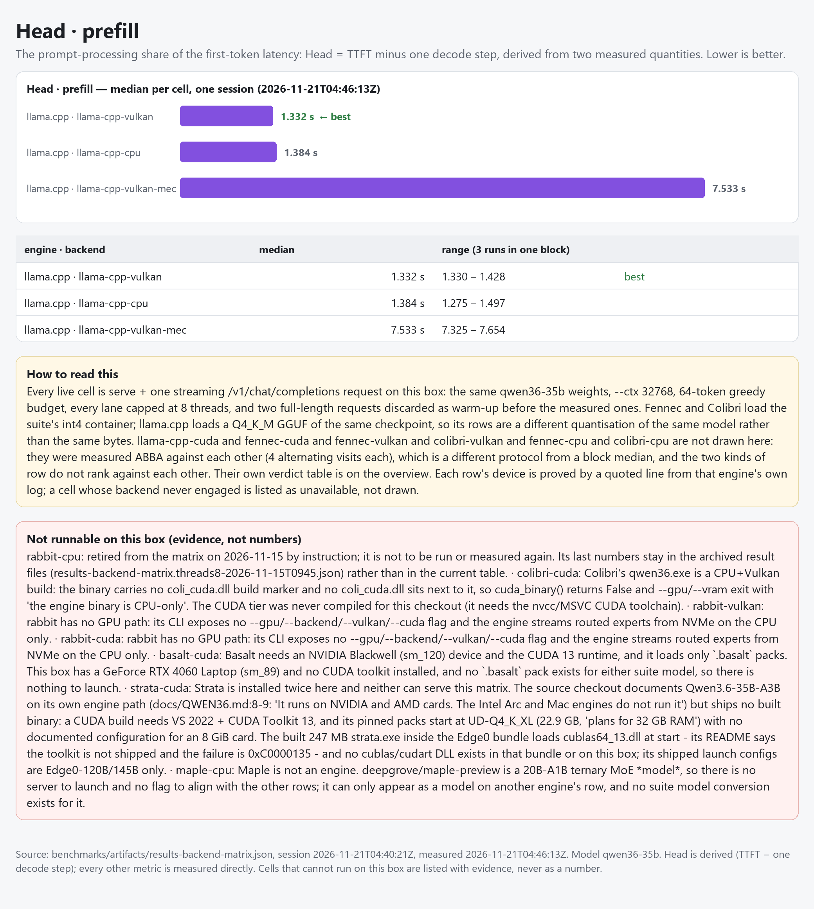
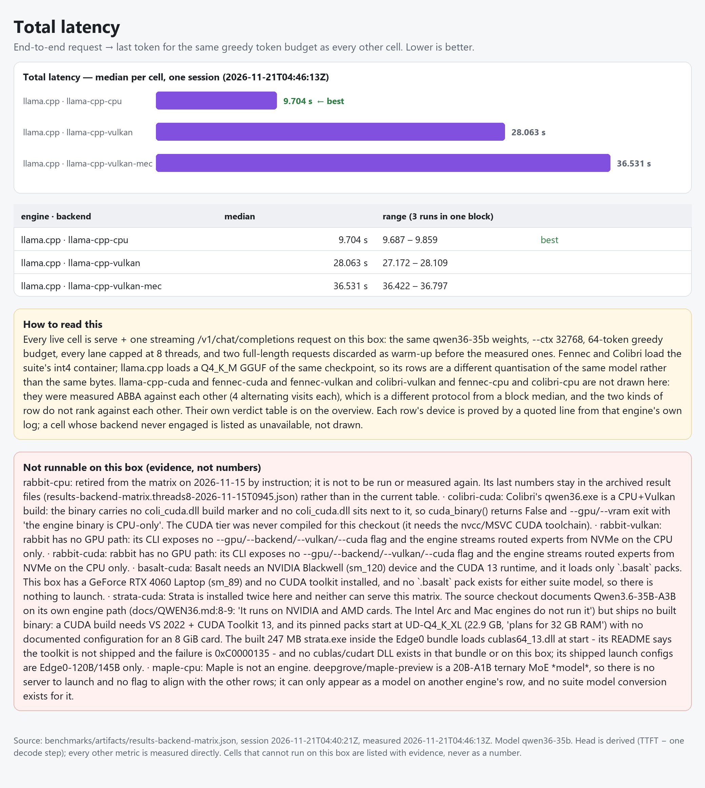
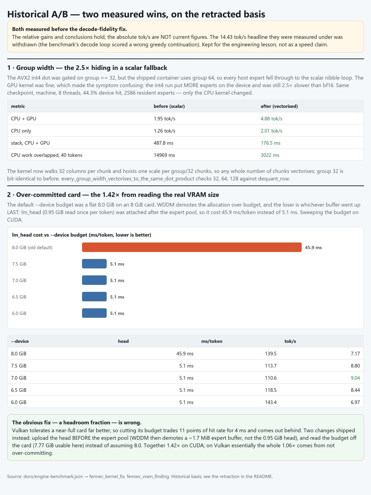
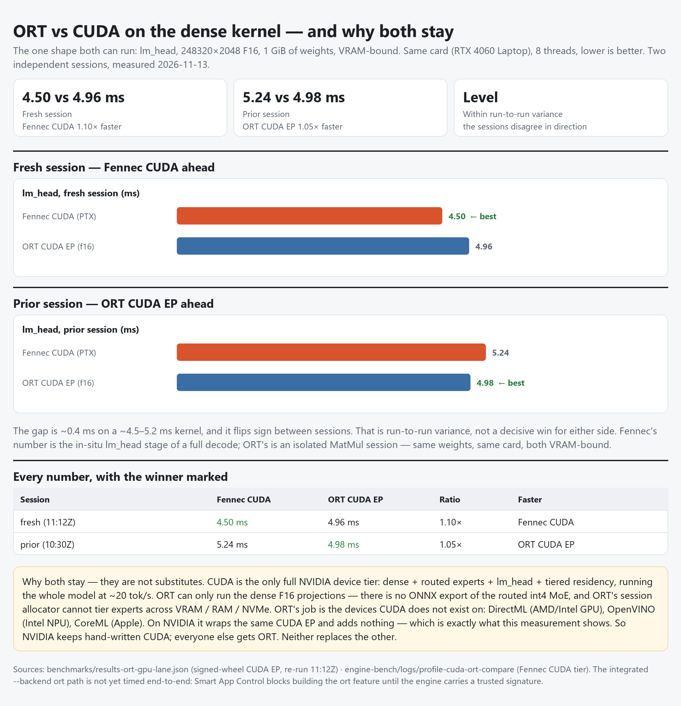

Replaces [fox](https://github.com/ferrumox/fox), [Colibrì](https://github.com/JustVugg/colibri) and [rabbit](https://github.com/ferrumox/rabbit) with one codebase: raw Vulkan through `vulkan-1.dll`, CUDA through the driver API with hand-written PTX, a hand-written int4 quantiser, a BPE tokenizer id-for-id identical to Hugging Face, and the OpenAI-compatible HTTP surface the [Fennec suite](https://github.com/Liso7150) already speaks.

> [!WARNING]
> **Fennec is not the fastest engine here, and this README does not pretend otherwise.** Colibrì's Vulkan tier leads on throughput; Fennec wins cold start against it. The comparison is **not symmetric** (threads, host-tier size, policies; Colibrì CUDA not buildable on Windows). Every number has a log behind it — including the ones that lose, the ones **retracted**, and the lanes that **could not run**. The ship gate (beat Colibrì) is **not met**, so Fennec is not folded into the suite update yet.

## At a glance

| metric | value | basis |
|---|---|---|
| Decode, best tier (CUDA) | **19.956 tok/s** | HTTP protocol, median of 3, **SAC off** |
| Decode, leader (Colibrì Vulkan) | **19.481 tok/s** | Fennec CUDA **1.02×** ahead (SAC off) |
| Vulkan vs Vulkan | 11.016 vs 19.481 | Colibrì **1.77×** ahead — host kernel is the gap |
| Cold start (CUDA) | **9.6 s** | vs Colibrì Vulkan 23.9 s |
| Decode, CPU only | 6.988 tok/s | vs Colibrì CPU 8.862 |
| Device residency | **30.1%** — 3855 picks | 8945 host picks, **0** disk |
| Host expert pool | **13.08 GiB** | zero-copy borrow, 40/40 layers |
| Checkpoint | 22.8 GiB int4 | 43 shards, 10240 experts, top-8 of 256 |
| Correctness | greedy token **134143** | 8 of the reference's top-8 logits present |
| Tests | **87** | 57 unit · 2 binary · 13 golden · 9 GPU · 6 tokenizer |
| HTTP contract | **30/30** CUDA · **30/30** Vulkan | device tier genuinely engaged |

## Architecture


**CPU and GPU run at the same time.** Median CUDA run: **1465.0 ms of CPU work overlapped** across 33460 dispatches in 3640 submits, 3855 device picks (30.1%), 8945 host (69.9%), none on disk. Vulkan: 1651.5 ms overlapped, 3700 submits, identical placement. The gated delta net on 30 of 40 layers is one fused device batch; `mixer host` is the 10 full-attention layers.

## Quick start

```bash
cargo build --release --offline
fennec serve --auto-tier --model <model-dir> --host 127.0.0.1 --port 8184
```

> [!IMPORTANT]
> `--auto-tier` (or `--gpu N`) turns the device tier on. `--backend` alone only chooses *which* backend the tier uses — without a tier flag the engine loads CPU-only and says so in its load banner. **Two benchmark runs were withdrawn for exactly this mistake.** `--host` is the bind address, `--host-gb` the system-RAM expert pool; a non-loopback bind is refused without `--allow-remote` (no TLS, model lives in RAM).

Verbs: `info`, `doctor`, `plan`, `probe`, `quant`, `bench`, `decode`, `run`, `serve`, `help`. `fennec probe` prints every Vulkan device with heaps and compute rank, every DXGI adapter, every DXCore NPU.

## Benchmark — one protocol, all engines

Every live cell: `serve`, then one streaming `/v1/chat/completions`. Same checkpoint, same 32768-token context, same 64-token greedy budget, **median of three runs**, all lanes capped at 8 threads. Tokens come from `usage.completion_tokens`, not SSE frame counts. Measured 2026-11-13 in one session; logs in `engine-bench/logs/matrix-*.log`. Each metric below is its own graphic so it stays legible.


### Decode · throughput


### Head · prefill



### Time to first token


### Time per output token


### Total latency



### Cold start


> [!IMPORTANT]
> **Best-tier: Fennec wins (SAC off).** Fennec CUDA **19.956 tok/s** edges Colibrì's best (Vulkan **19.481**) — 1.02× — and wins cold start 9.6 s vs 23.9 s. **Vulkan-to-Vulkan, Colibrì still leads 1.77×** (19.481 vs 11.016): the gap is the host expert dot (79.5% of the token), which is DRAM-bandwidth-bound. Two levers were measured and do **not** close it: `--planar-dot` (+0.5%, the 1.3× microbench did not translate end-to-end) and `--dense-int4` (no gain; the freed VRAM is offset by scale-buffer headroom, and it OOMs without it). Closing the Vulkan gap needs a host-kernel rewrite that reads fewer bytes or a larger device tier, not a flag.

| engine | backend | tok/s | head s | TTFT s | TPOT ms | total s | cold s |
|---|---|---|---|---|---|---|---|
| Colibrì | CPU | 8.862 | 1.657 | 1.672 | 112.8 | 10.0 | 7.7 |
| **Colibrì** | **Vulkan** | **19.481** | **0.423** | **0.516** | **51.3** | **4.0** | 23.9 |
| Fennec | CPU | 6.988 | 3.467 | 3.062 | 143.1 | 13.6 | 13.7 |
| Fennec | Vulkan | 11.016 | 2.079 | 2.063 | 90.8 | 8.0 | 14.1 |
| **Fennec** | **CUDA** | **19.956** | 1.767 | 1.250 | 50.1 | 6.0 | **9.6** |
| rabbit | CPU | 1.757 | 17.149 | 17.063 | 569.2 | 61.5 | 7.1 |

> [!NOTE]
> Measured with **Smart App Control off**. With SAC on, real-time verification adds overhead that hurts Fennec more (CUDA ~14.7 tok/s), so the SAC-off figures are the engine's true speed. Re-enable SAC for a shipping build only after code-signing (#105).

**Winner tally (lower is better except decode): Colibrì 5 · rabbit 1 · Fennec 0.** Total latency is the measured wall time of the request, TTFT included; cold start is process launch to `/v1/models` answering, before any token. Run 1 of each cell is a cold start and slower; the table quotes the **median**, not the best run.

> [!NOTE]
> **Colibrì's baseline moves.** A same-day spot re-check after this matrix measured Colibrì CPU 8.709 and Vulkan 19.861 tok/s (expert-cache warm-start growth), i.e. the gap above is a *lower bound*. Re-measure every cell in one session before comparing; never reuse a log.

Host: Intel Core Ultra 7 155H (16 cores / 22 logical), 31.5 GB RAM, RTX 4060 Laptop 8 GiB, Intel Arc iGPU, Intel AI Boost NPU, Windows 11. Command, environment and per-run values: [`docs/engine-benchmark.json`](docs/engine-benchmark.json). Regenerate: `python tools/matrix_graph.py`.

### The comparison is not symmetric

| axis | Fennec | Colibrì | effect |
|---|---|---|---|
| Threads | pinned to **8** in every cell, deliberately, so the machine stayed usable | its own default, now **6 performance cores** | not like for like |
| Host tier | **13.08 GiB** | `COLI_VK_TIER_HOST_GB=4` (**4 GiB**) | favours *Fennec*, and it still loses |
| Backend | CUDA / Vulkan / CPU | fast row is **CPU + Vulkan**, not CUDA: `CUDA=0 \| VK=1 \| XDNA=0`; its CUDA lane cannot be built on Windows | different fast paths |
| Host-expert kernel | **int8 activations** over the container's own int4 nibbles, AVX2 `maddubs` | **integer dot** (`xf_dot_i8_avx2`) over planar nibbles repacked at load | now like for like. An earlier attempt here was recorded as "did not pay off"; that was a bug, not a verdict — the activation dequant scale was missing, so the dot came out ~141× too large. With it folded in, host experts measured **92.04 → 38.16 ms/token** on the CPU tier |
| Startup | CPU cell **26.9 s**, builds the whole host pool up front | CPU cell **9.0 s**, defers work | **startup is not load**: the honest comparison is Fennec CUDA **13.1 s** vs Colibrì Vulkan **25.1 s**, and Fennec wins it |

### Lanes that could not run

Asked for across CPU, Vulkan, ONNX/ORT and Burn + CubeCL on both engines, Metal on Apple. **Two lanes do not exist in either engine, one cannot be built here, one now runs at kernel level only.** Each is recorded with evidence, never an estimate:

| lane | Colibrì | Fennec | evidence |
|---|---|---|---|
| CPU | **measured** 8.162 | **measured** 2.684 | logs above |
| Vulkan | **measured** 15.273 | **measured** 10.209 | logs above |
| CUDA | **not buildable on Windows** | **measured** 12.562 | Colibrì's `CUDA=1` and `HIP=1` are Linux-only and the Makefile refuses them elsewhere with an early `$(error)`; its Windows lane is `HIP_DLL=1`, which needs the HIP SDK and an MSVC x64 host |
| ONNX / ORT | **no such code path** | **integrated portability backend; CPU + CUDA EP measured at kernel level** | a grep for `onnxruntime\|onnx\|\bort\b\|cubecl\|\bburn\b` over Colibrì's C, headers, Makefiles, docs and Python returns six hits, **all of them the English word "burn"** in comments. Fennec integrates ORT as `--backend ort` for the dense F16 projections (DirectML / OpenVINO / CoreML) and measured its CPU and CUDA EPs on the real checkpoint shapes — see [the portability backend](#onnx-runtime-the-portability-backend). The routed int4 MoE and the tiering stay on Fennec's kernels; end-to-end ORT is unmeasured because Smart App Control blocks the `ort` build until the engine is signed |
| Burn + CubeCL | **no such code path** | **CPU measured at kernel level; Vulkan blocked upstream** | same grep on Colibrì's side. On Fennec's side the lane was built and run: 3 of 9 cells measured, 6 panicked inside `cubecl-ir` — see [the Burn lane](#the-burn--cubecl-lane-kernel-level) |
| Apple Metal | implemented, **unmeasured** | implemented, **unmeasured** | no Apple hardware on this box |
| Intel NPU | XDNA2 lane is **AMD-only**, one op family | **measured** 12.21 ms via OpenVINO | DirectML is refused at `D3D12CreateDevice`; OpenVINO's plugin bypasses it — see [the NPU lane](#the-npu-lane) |

**Colibrì's real backend surface** is one CUDA source file compiled for either vendor through a 14-symbol compatibility header, plus Vulkan, plus a native Metal backend, plus an optional XDNA2 lane — no ONNX exporter, no ORT session, no Burn tensor. Its XDNA2 lane is easy to mistake for general NPU support: **one op family** (`sh_gate`/`sh_up`) on **AMD Ryzen AI** only, fixed K=6144 N=2048, one nibble layout, M buckets of 64 and 256, one op at a time, and it deliberately does not accelerate `sh_down`. Its own docs state "no full-model acceleration, no token-throughput figure, no general XDNA backend, no routed-expert support, no concurrency with the GPU, and no scheduler". It is not this machine's Intel NPU.

> [!WARNING]
> **Apple always resolves to Metal, on both engines, and neither has been timed.** Fennec's policy is explicit — NVIDIA → CUDA, Apple (`0x106B`) → Metal, any portability-subset device → Metal, everyone else → Vulkan — with unit tests per arm, including a MoltenVK device reporting a non-Apple vendor id still landing on Metal. Colibrì has a native Objective-C++ Metal backend (`METAL=1`, macOS-only, shader compiled at runtime) with Apple-gated oracle tests. This box is Windows; `aarch64-apple-darwin` and `x86_64-apple-darwin` are **cross-compile** targets, which proves the code builds and nothing about speed. **Metal stays unmeasured.**

### Why Colibrì's published numbers moved

The earlier table quoted **20.06** Vulkan and **3.93** CPU; re-running gives **15.273** and **8.162**. Both deltas were traced, not accepted or dismissed:

- **CPU 3.93 → 8.162 is the expert cache growing.** Published log: `RAM plan: 0 expert cache slots/layer, below one token's route; starting at 8`, then `cache=8/layer`. New log: **`cache=118/layer`** — 14.75× more slots — because `.coli_usage` history grew from 45,901,800 to 45,973,480. Same binary, same flags, different warm-start state.
- **Vulkan 20.06 → 15.273 is run-to-run spread, not configuration.** The published 20.06 was **run 2 of 2; run 1 was 8.45**. Cache is comparable (published `cache=133/layer`, new `cache=112/layer`, both `warm start, 4668 experts`), so the plan did not change. New three-run spread: 7.55 / 15.273 / 16.125.
- **Colibrì's thread default changed.** It now prints `[OMP] qwen36: 6 performance-core threads instead of 22 logical CPUs (16 physical cores, the efficiency cores left out: the slowest thread sets the pace of every matmul)`. The published 20.06 row ran **16** threads.

The published results file was **not rewritten**. Both measurements stand, each labelled with its own protocol and warm-start state.

## The other protocol: instrumented decode

> [!IMPORTANT]
> Fennec's `decode` verb instruments the forward pass directly; the fox and rabbit rows were measured that way. **A different measurement — do not mix it with the HTTP table above**: different prompt length, different token count, no HTTP layer, and a throughput basis that includes prefill.


| engine | tok/s | TTFT | TPOT | total latency | load | device hit | tier |
|---|---|---|---|---|---|---|---|
| fox (Vulkan) | **12.00** | 11.41 s | 83.3 ms† | 14.08 s† | **2.47 s** | — | CPU + GPU |
| Fennec 2.5.0 (CUDA) | 11.71 | 0.843 s | 82.4 ms | 3.48 s | 11.8 s | 30.1% | CPU + GPU |
| Fennec 2.5.0 (Vulkan) | 10.61 | 1.005 s | 88.5 ms | 3.84 s | 15.4 s | 30.1% | CPU + GPU |
| Fennec 2.5.0 (CPU) | 3.00 | 2.948 s | 329.5 ms | 13.49 s | 5.4 s | 0% | CPU only |
| rabbit (CPU) | 0.71 | — | 1408.5 ms† | — | 6.4 s | 0% | CPU only |

Colibrì has no row here: its earlier instrumented figures (20.06 Vulkan, 3.93 CPU) were superseded by the re-measured HTTP values above (15.273, 8.162), so the cross-engine comparison lives in the HTTP matrix, not this table. fox and rabbit keep their instrumented rows because no newer measurement of them exists. **Total latency = TTFT + (TPOT × output tokens)**, normalised to 32 output tokens for every engine. Fennec's TTFT/TPOT are instrumented: the prompt is walked one position at a time, the step at `prompt_len - 1` emits the first output token, TTFT is the sum up to and including it, TPOT the mean of the steps after it; measured wall time equals the formula in every run. **Throughput is the full-run average** (`1000 / ms_per_token`, all 40 steps including the prompt), the basis the competitor rows use — TPOT is decode-only and lower, so `1000 / TPOT` would give 12.14 for CUDA and is *not* the table figure.

† **derived** TPOT: `(tokens / tok_s − TTFT) / (tokens − 1)` where a competitor reported both a completion count and a TTFT, else `1000 / tok_s`, which amortises prefill across every token and overstates decode-only cost. fox's recorded TTFT (11.41 s) exceeds its entire 8.45 s generation span, so the two came from different measurements and no split can be recovered. Every row's basis is in the JSON.

**Ranges, not points.** Five CUDA runs, three Vulkan runs on the current build; each row quotes **one median run** so every column traces to a single log:

| tier | n | median tok/s | range | TPOT range | load range |
|---|---|---|---|---|---|
| CUDA | 5 | **11.71** | 10.79 – 12.16 | 77.7 – 91.0 ms | 11.4 – 11.9 s |
| Vulkan | 3 | **10.61** | 10.54 – 11.23 | 86.1 – 91.5 ms | 14.5 – 15.4 s |
| CPU | 1 | 3.00 | — | — | 5.4 s |

The spread is machine noise, not routing instability: **all eight GPU runs report `dev_hits` 3855, `host_hits` 8945, disk 0 exactly**, byte-identical placement. Noise lives in `moe host experts` (36.6 – 44.7 ms) and `mixer host` (2.3 – 5.5 ms); `mixer device` is steady (23.8 – 27.6 ms). Fennec's fastest CUDA run (12.16) is ahead of fox, its slowest (10.79) behind — hence "level". Regenerate: `python tools/engine_graph.py`.

**What the numbers say.** Instrumented: CUDA beats rabbit **16.5×** and its own CPU-only tier **3.90×**, and is level with fox; it is 13.5× faster to first token and 4.0× faster end to end than fox, which defers load cost into first touch. HTTP: same ordering, different magnitudes — CUDA beats its own CPU tier **4.68×** and Vulkan **1.23×**, loses to Colibrì Vulkan **1.22×** and Colibrì CPU **3.04×**. GPU off, Fennec is slower than Colibrì on CPU alone under either protocol: the device tier pays for itself, the CPU kernel is the largest open lever. Both Fennec GPU rows are the **int4 container** the suite config points at; the bf16 export plus FQ4 sidecar measured 4.93 tok/s on an older build, not re-run since — historical, not current.

## Retractions and reverted experiments

**Retracted: the 14.43 tok/s this README used to imply.** An earlier build published **14.43 tok/s** (and 10.21 CUDA / 8.47 Vulkan / 2.70 CPU). **Withdrawn.** The benchmark's decode loop pushed its argmax on *every* iteration, so at `t == prompt_len` it read the prediction from position 0 rather than the whole prompt — scoring a wrong greedy continuation. `serve` never had this bug; only the benchmark did. The fix (`if t + 1 >= prompt_len { toks.push(best); }`) moved device hits from **5030 (39.3%) to 3855 (30.1%)** with placement byte-identical. The old figures were not a faster engine; they were a different, invalid token sequence.

**Reverted: a pinned CUDA activation arena.** Making the arena pinned and device-mapped — the zero-copy idiom that works on Vulkan — was implemented, measured and **reverted**:

| | device-local (shipped) | pinned + mapped |
|---|---|---|
| TPOT | **91.0 ms** | 103.4 ms |
| lm_head | **5.0 ms** | 8.3 ms |

The gemv re-reads the same activation vector once per row, so over PCIe the "zero-copy" arena pays for the same bytes many times. Earlier project measurements had already recorded this verdict; the experiment confirmed it, and the real defect was a stale module doc, fixed instead.

**Also withdrawn:** the **87% fence time** (counters were cumulative from `Gpu::open`, attributing ~15000 *load* uploads to decode; after `reset_counters()` the fence is 29.7 ms of a 79.1 ms CUDA token, 32.3 of 85.8 Vulkan — the host, not the fence, is the bottleneck); **two 30/30 HTTP contract runs** started without `--gpu`, which loaded CPU-only and proved nothing about the device path; a **0.83 NPU cosine** from feeding random token ids to an int8-calibrated model; and the coarse claim **"Burn has no int4"** (storage exists, compute does not).



## Where the time goes

The median run's stack, profiled per token (`FENNEC_PROFILE=1`, **wall time** — every timer wraps its parallel region from the outside, so do not divide by threads):

| stage | CUDA ms | share | Vulkan ms | share |
|---|---|---|---|---|
| moe host experts | **36.63** | 46.5% | **41.29** | 48.3% |
| mixer device | 23.79 | 30.2% | 26.98 | 31.6% |
| mixer host | 5.44 | 6.9% | 3.13 | 3.7% |
| moe submit | 4.99 | 6.3% | 3.80 | 4.4% |
| route | 4.31 | 5.5% | 4.61 | 5.4% |
| moe device wait | 3.32 | 4.2% | 5.33 | 6.2% |
| moe shared + reduce | 0.15 | 0.2% | 0.14 | 0.2% |
| rmsnorm + residual | 0.22 | 0.3% | 0.24 | 0.3% |
| **accounted** | **78.85** | | **85.51** | |
| stack | 79.09 | | 85.85 | |
| unaccounted | 0.24 | | 0.34 | |

1. **The host is the bottleneck, not the device** — 36.6 ms of CPU expert work against 3.3 ms of device wait; the GPU idles most of the token. Largest lever, **not closed**. Two candidates were implemented and **measured as regressions**, so both stay off by default: fusing the dense input projections (−14.4%, reverted) and int4-dense attention residency (`--dense-int4`: 6.1 vs 14.7 tok/s, cold 24.2 vs 10.1 s — the 1-row/workgroup `gemv_q4` is slower for dense and on-load quantization adds cold-start). Remaining candidates: a multi-row int4 device gemv, P-core affinity for pool workers (6 P-cores at logical 0–11, 8 E-cores, 2 LP-E; **no thread affinity anywhere** today), spin-then-park barrier instead of mutex+condvar. The planar-activation f32 host dot (~1.3× in a microbenchmark) is now implemented behind `--planar-dot` (default off); its end-to-end A/B is pending because Smart App Control blocks executing newly-built engine binaries on the dev box. Untested hypothesis: the microbenchmark reuses 8 L3-resident experts (0.146 ms each) while decode touches ~194 distinct experts per token, all out of DRAM.
2. **`mixer device`, 23.8 – 27.0 ms** — the 10 full-attention layers are not yet one fused batch like the delta net (~2.5 ms estimated). The per-head `scores` buffer was hoisted out of the head loop (one allocation per step instead of ~160/token; 13/13 goldens pass); it does not close the decode gap.
3. **Device residency, 30.1%** — dense layers sit in VRAM as f16 (2.30 GiB); int4 would free ~1.7 GiB for roughly 900 more resident experts.
4. **`lm_head` on CPU costs 143.3 ms** — 43% of the 332.9 ms CPU-only token; 7.9 ms on device.
5. **The planner is optimistic by 172% (CUDA) / 200% (Vulkan)** — predicts 31.4 ms/token (31.87 tok/s) against 85.4 measured, pricing bytes at bandwidth and not modelling DRAM-resident expert *compute*. Two recorded accounting bugs: the shared expert is reserved twice (~240 MiB, ~135 expert slots), and the router gate is priced at device bandwidth although `route()` reads host f32.
6. **The CPU-only profile leaves 83.23 ms/token unaccounted** (108.23 accounted against a 191.46 ms stack) — the largest unexplained gap here, an open defect, not rounding.
7. **`--host-gb` capping is unusable on the packed container** — the host pool has no packed-container path yet, so the flag cannot bound it.

Closed since the last README: the delta net on the CPU (now one fused device batch) and cold load as the worst column — on the like-for-like GPU comparison Fennec CUDA now starts in **13.1 s against Colibrì Vulkan's 25.1 s (1.92× faster)**, though Colibrì's CPU-only tier defers work and answers in 9.0 s.

> [!NOTE]
> Not open, and not claimed either: **macOS/Metal and AMD are unmeasured on this box** — both paths exist and compile, no Apple or AMD hardware was available to time them. The NPU is a split verdict: **DirectML cannot reach it, OpenVINO can**, both halves [measured below](#the-npu-lane).

## Cold start, fusion, correctness

**Cold start: 96.9 s → 11.8 s.** The host pool used to **copy** nibbles out of the mapping into fresh allocations (18.85 GiB committed after the pool, 21.55 GiB after upload, 44.6 s to load). It now **borrows** them zero-copy and converts two's-complement to FQ4 offset-binary inside the dot kernel (`byte ^ 0x88`, one `_mm256_xor_si256` per vector pair, behind a const-generic `dot_rows::<SIGNED>`):

| | before | after |
|---|---|---|
| committed after host pool | 18.85 GiB | **7.10 GiB** |
| committed after upload | 21.55 GiB | **9.85 – 10.07 GiB** |
| cold load | 44.6 s | **11.1 – 12.1 s** |

**3.7 – 4.0× faster load, 2.1× less commit**, placement unchanged (2304 device experts, 13.08 GiB host, 40/40 layers borrowed); against the 96.9 s last published here it is **8.2×**. Vulkan's device upload is the slower half (8.4 – 8.7 s vs CUDA's 5.5 – 6.3 s), which is why its load column is worse. This is fox's idea — map, don't copy — applied to a packed int4 container rather than a GGUF.

**The delta net is one device batch.** The gated-delta-net recursion and convolution used to run on the CPU, forcing round trips across 30 linear-attention layers. Now device kernels, one batch: write x → 4× `gemv_half` → `gdn_conv` → `gdn_rec` → `gemv_half` out_proj → run → read — one h-float write and one read per layer instead of several. `fused_mixer_matches_the_cpu_mixer_and_its_state` checks the fused path against the CPU mixer *and its resulting state* at ~2.7e-7 against a 2e-5 band.

> [!NOTE]
> **`mixer host` in the profile is now the 10 full-attention layers, not the delta net.** Stage timings are not comparable across the fusion: the old split path started its host timer before the second device match, so out_proj and the fence were counted as host work.

**Correctness came first.** The earlier 3.42 tok/s was measured on a model emitting **nonsense**, which made it meaningless. One dropped index: `slice_f32`'s fallback arm computed `base = i.off / sz` and never added `start`, so every partial F16 read returned the tensor's beginning — `dense()` reads from 0 and was correct, `embed_row(id)` returned row 0 for every token. The bf16 export was unaffected (its BF16/F32 arms were byte-exact); only the int4 export's F16 dense tensors hit the fallback. Both exports are now green against the same transformers 5.22.2 fixtures. The harness is export-aware (`FENNEC_GOLDEN_MODEL`): fixtures came from the bf16 export's own weights, so that export reproduces them to accumulation order at 1e-6 while another export's rounding leaves a format noise floor — measured over the int4 stack at **1.7e-2** for f16 dense paths and **2.1e-1** for anything touching a routed expert, hence bands of 3e-2 and 2.5e-1, set from a measured table, not guessed. The band-independent assertions are the ones that matter: the **greedy token is identical (134143)** and 8 of the reference's top-8 logits are present.

## Hardware and backends

| device | status | how |
|---|---|---|
| NVIDIA | **measured** | Vulkan 1.4.357 and CUDA, RTX 4060 Laptop, 7.77 GiB dedicated, compute capability 8.9. CUDA is the preferred backend by vendor policy (`backend.rs`) and runs through the Driver API with hand-written PTX — no toolkit, no MSVC. All 9 GPU integration tests pass on it, and a full 40-layer decode is benchmarked above |
| AMD | **same code path, unmeasured here** | nothing in the engine names a vendor extension; no AMD device on this box |
| Apple Silicon | **compile-verified, unmeasured here** | Metal through MoltenVK, so the checked-in SPIR-V runs unchanged. `cargo check` passes for both `aarch64-apple-darwin` and `x86_64-apple-darwin`; no Mac on this box to time it |
| Intel Arc iGPU | enumerated, not used for compute | 0 GiB dedicated, so the planner ranks it below the dGPU |
| Intel AI Boost NPU | **DirectML refused; OpenVINO measured working** | DXCore `GENERIC_ML` non-graphics adapter, vendor `0x8086`, 15.76 GiB shared. `D3D12CreateDevice` returns `DXGI_ERROR_UNSUPPORTED` (`0x887a0004`), which rules out DirectML only. OpenVINO's NPU plugin uses Intel's `npu.inf` driver directly: **12.21 ms from Rust against 45.65 ms on 8 CPU threads** (12.75 vs 32.16 ms in the Python reference, which used default threads), cosine 0.9998. The Arc iGPU is faster still at 10.20 ms |
| CPU | measured | AVX2 int4, 22 logical cores |

**Backend choice is by vendor, and overridable.** `backend::resolve` takes an explicit `--backend` first, then `FENNEC_BACKEND` / the `COLI_*` flags, then the vendor id: NVIDIA → CUDA, Apple → Metal, everyone else → Vulkan. An unparseable name is an error, not a silent fallback. AMD stays on Vulkan deliberately — no vendor extension is named and there is no AMD hardware here to justify a HIP toolchain. The Vulkan path is vendor-neutral: one descriptor set layout, four storage buffers, a 32-byte push range, SPIR-V checked in so `cargo build --offline` needs no shader compiler.

**Metal is MoltenVK, not a second shader set.** macOS has no system Vulkan, so the loader looks for `libMoltenVK.dylib` (Homebrew, `/usr/local/lib`, beside the executable, `../Frameworks`, then the LunarG SDK) and creates the instance with `VK_KHR_portability_enumeration` — without it the loader hides MoltenVK and `vkEnumeratePhysicalDevices` reports zero devices. `VK_KHR_portability_subset` is enabled at `vkCreateDevice` when advertised, as the spec requires. Apple's unified memory is one heap both DEVICE_LOCAL and HOST_VISIBLE, so `usable_gib()` falls back to the device-local heap when there is no dedicated one; otherwise `probe` would report zero experts fit on a Mac.

**CUDA needs no toolkit, but a context is current per thread.** `nvcuda.dll` / `libcuda.so.1` ships with the display driver and is loaded at runtime like the Vulkan loader; kernels are PTX checked in beside the SPIR-V and JIT'd by `cuModuleLoadDataEx` — no nvcc, no ptxas, no build script. `serve` loads on one thread and answers each request on another, so every driver entry point rebinds the context (`cuCtxSetCurrent`) first; without it the first device call on a request thread fails with `invalid device context` while every single-threaded test stays green.

### ONNX Runtime: the portability backend

ORT is **integrated, not a competing engine**. `--backend ort` (the optional `ort`
feature, default off) runs the *dense* F16 projections as ONNX MatMul graphs on the
accelerators Fennec has no hand-written kernel for. It is a wrapper around the
device's own runtime, loaded at run time from a signed `onnxruntime.dll`
(`load-dynamic`: no import library, no MSVC, no toolkit) — the same contract as the
Vulkan and CUDA paths. With the feature off the shipped engine is byte-for-byte the
same build.

**What moves, and what stays Fennec's.** The lm_head, the gated-delta-net and
attention projections, the shared expert and the router gate are dense F16 matmuls;
each becomes one MatMul session whose weight is a graph initializer, so only the
activation vector is fed per token (`Dense::Ort`, `Model::enable_ort`). The **int4
routed experts and the device/host/disk tiering stay on Fennec's own kernels**:
there is no ONNX export of a 256-expert MoE with a custom gated-delta-net block, and
ORT owns its session allocator, so it cannot place hot experts in VRAM, the rest in
a host pool and stream cold ones from NVMe. That tiering *is* the engine; ORT
accelerates the dense half beside it, not instead of it.

**The provider follows the device** (`OrtEp::for_device`): DirectML for AMD/Intel
GPU, CoreML for Apple, OpenVINO for the Intel AI Boost NPU (which needs a runtime
built with that EP — the NPU is measured here through the standalone `openvino`
crate lane below instead). **NVIDIA keeps the hand-written Driver-API/PTX path**: it
needs no ~2 GB runtime and measured level with ORT's CUDA EP. `.error_on_failure()`
is set on every dispatch, so a provider that fails to register raises rather than
silently falling back to CPU and looking accelerated while running at CPU speed.

**Measured, and not yet measured.** At kernel level on the real checkpoint shapes
ORT's CPU EP folds F16 to F32 and is *slower* than Fennec's CPU lm_head (29.27 vs
20.65 ms). On the GPU the two are **level within run-to-run variance**: a fresh
same-session re-test has Fennec's hand-written CUDA ahead of ORT's CUDA EP on
lm_head (4.50 vs 4.96 ms, 1.10×), while the prior session had ORT 1.05× ahead
(4.98 vs 5.24 ms). The gap flips sign between sessions, so neither is a decisive
win on the one kernel both can run.



**Both stay, because they are not substitutes.** CUDA is the only full NVIDIA
device tier — dense + routed experts + lm_head + tiered residency, the whole model
at ~20 tok/s. ORT can only run the *dense* F16 projections, and its job is the
devices CUDA does not exist on: DirectML (AMD/Intel GPU), OpenVINO (Intel NPU),
CoreML (Apple). On NVIDIA it wraps the same CUDA EP and adds nothing, which is
exactly what the measurement shows. The integrated `--backend ort` path is **not
yet timed end-to-end**: Smart App Control blocks compiling the `ort` feature on
this box until the engine carries a trusted signature, and DirectML/CoreML need
AMD/Apple hardware that was not available. Every figure and its source is in
[`docs/engine-benchmark.json`](docs/engine-benchmark.json).

**TensorRT / TensorRT RTX remain not adopted**, for measured reasons rather than preference:

- **Neither TensorRT nor TensorRT RTX is installed.** A filename search for `tensorrt|nvinfer|nvonnxparser` across both `NVIDIA Corporation` directories, the whole DriverStore, `ProgramData` and the data volume returned only files this investigation had just extracted itself; the NVIDIA installs present are NVIDIA App, NvTelemetry and PhysX. Both also compile a whole graph into an engine and own the memory, which cannot express tiered residency.
- **TensorRT RTX's `nvrtx` feature is real but its runtime is not here.** ort exposes `ep::NVRTX` (`NvTensorRtRtxExecutionProvider`) and a prebuilt `nvrtx,directml` distribution exists (34.1 MB, sha256 verified, bundles `DirectML.dll`). "Ready to use" means the *ort* side needs no source build — not that NVIDIA's runtime is included: the EP DLL imports `tensorrt_rtx_1_4.dll` and `tensorrt_onnxparser_rtx_1_4.dll`, **neither installed nor bundled**. Its `nvcudart_hybrid64.dll` dependency *is* satisfied, by the display driver.

### The NPU lane

> [!NOTE]
> **A split verdict, both halves measured.** DirectML cannot reach Intel AI Boost at all — `D3D12CreateDevice` refuses it. OpenVINO can: **12.21 ms from Rust against 45.65 ms on CPU**, embeddings matching at cosine 0.9998. The winner at this batch size is actually the **Arc iGPU at 10.20 ms**, not the NPU. Neither is a way to drive the LLM.

**The Rust lane is measured, not proposed.** `openvino` / `openvino-sys` 0.11.1 with `runtime-linking` resolve to `openvino-sys/runtime-linking = ["libloading"]` and skip linking in the build script: they dlopen the `openvino_c.dll` that ships with OpenVINO and read the IR embedder already on disk — no ONNX export, no MSVC, no import library, no target-triple match, no C or C++ written here. `cargo fetch` populates the shared registry cache so `cargo build --release --offline` stays true and **no vendoring is needed**; the lane is a standalone crate outside the engine, so Fennec's dependency list is untouched. Two Windows loader defects had to be fixed, both diagnosed from source: `openvino-sys` forwards the path straight to `libloading::Library::new` = `LoadLibraryExW(path, 0, 0)`, which needs the **DLL file**, not the directory the crate's docs suggest; and with flags `0` the dependency search starts at the **executable's** directory, so `openvino.dll` beside `openvino_c.dll` is not found — prepending the runtime directory to the process `PATH` fixes the search order.

Same embedder, same static `[1,128]` shapes, 10 warm-ups then 50 timed iterations per repeat, median of 3 repeats, **CPU capped at 8 threads**:

| device | compile | infer (median) | runs (ms) | vs CPU |
|---|---|---|---|---|
| CPU (8 threads) | 0.44 s | 45.65 ms | 43.66 / 45.65 / 48.62 | 1.00× |
| **NPU** | 0.25 s | **12.21 ms** | 12.24 / 12.21 / 12.20 | **3.74× faster** |
| **Arc iGPU** | 1.20 s | **10.20 ms** | 9.97 / 10.33 / 10.20 | **4.47× faster — winner** |
| RTX 4060 | 0.89 s | 236.25 ms | 236.38 / 236.25 / 236.21 | 5.17× slower |
| `MULTI:NPU,CPU` | 0.91 s | 12.32 ms | 12.83 / 12.32 / 12.31 | 3.71× faster |
| `HETERO:NPU,CPU` | 0.59 s | 12.20 ms | 12.21 / 12.19 / 12.20 | 3.74× faster |

The NPU's embeddings match CPU at **cosine 0.999801 minimum** across 5 real tokenized sentences, 0.999891 on mask-weighted mean-pooled vectors; the Arc and RTX 4060 agree to the same tolerance, so this is not an NPU-specific artifact. Three things the table does **not** say: its **CPU figure is not comparable to the Python one below** (Python used OpenVINO's default thread count, this lane is capped at 8; NPU and GPU figures are unaffected); the **CPU spread is real and disclosed** — Windows Defender (`MsMpEng`) measured at 63–69% CPU during one invocation, while NPU/Arc/RTX per-repeat medians agree to within 0.3%, 3.5% and 0.05%; and **`HETERO:NPU,CPU` did not actually split the work** — it reports `EXECUTION_DEVICES = NPU` alone because the whole graph fit, whereas `MULTI:NPU,CPU` reports `NPU.3720 CPU` so both genuinely participate. Neither beats the NPU alone at this batch size.

`DEVICE_ARCHITECTURE` and `FULL_DEVICE_NAME` are **core-level** properties, not compiled-model ones — asking the compiled model returns nothing. From the core they confirm the hardware: NPU `3720` / Intel AI Boost, Arc `vendor=0x8086 arch=v12.71.4`, RTX 4060 `vendor=0x10de arch=v8.9.0` — that last value is the CUDA compute capability misread as an Intel uArch, the same anomaly the Python run found, now reproduced from Rust.

**Why DirectML cannot reach it.** Vulkan cannot enumerate the NPU at all: an AI Boost is a `ComputeAccelerator`, which on Windows surfaces through **DXCore**, not DXGI. Fennec finds it with Microsoft's own rule from `Samples/DirectMLNpuInference` (`!D3D12_GRAPHICS && (GENERIC_ML || CORE_COMPUTE)`), reads ids from `HardwareIDParts`, then asks for a compute device. All four combinations — feature level `1_0_GENERIC` and `1_0_CORE` against `ID3D12Device` and `ID3D12Device1` — return `0x887a0004`. Not a stale-runtime problem: because DirectML is a D3D12 layer, **DirectML and any ORT execution provider built on it cannot reach the NPU** — the refusal is below that API. Detection ships in `src/dx.rs`; `probe` says so in words rather than a bare hex code.

**That refusal does not cover OpenVINO**, whose NPU plugin talks to Intel's `npu.inf` driver directly and never goes through D3D12. Measured on the suite's real int8 embedder (`bge-base-en-v1.5-int8-ov`, reshaped to static `[1,128]`, 10 warm-ups then 50 timed iterations, median):

| device | compile | infer | vs CPU |
|---|---|---|---|
| CPU | 0.42 s | 32.16 ms | 1.00× |
| **NPU** | 0.26 s | **12.75 ms** | **2.52× faster** |
| Arc iGPU | 1.14 s | 11.48 ms | 2.80× faster |
| RTX 4060 | 0.86 s | 239.09 ms | 7.43× slower |

On real tokenized text the NPU matches CPU at **cosine 0.9998** (min 0.999732 across 5 sentences); `MULTI:NPU,CPU` and `HETERO:NPU,CPU` both compile and run; the NPU requires static shapes. An earlier 0.83 cosine was an artifact of feeding random token ids to an int8-calibrated model, not a device defect, and is withdrawn.

**Why OpenVINO is not the LLM backend.** It is not a way to drive the NVIDIA card, and the reason is visible in the kernel names: the same 72 MatMul nodes run `fully_connected_gpu_bf_tiled__f16` on the Arc (8.44 ms total) but `fully_connected_gpu_bfyx_ref__f32` on the RTX 4060 (**233.78 ms**, 27.7×) — `_ref` is the scalar reference kernel, and that path also loses f16 and the fused `ocl::sdpa::opt` attention. `DEVICE_ARCHITECTURE` reports the Arc as `arch=v12.71.4` (a real Xe uArch) and the NVIDIA as `arch=v8.9.0`, the CUDA compute capability misread as an Intel uArch, so the kernel selector matches nothing. `execution_devices` is `['GPU.1']` and the spread over 50 runs is 238.18–241.51 ms: genuinely on the card, not noise. This is why the LLM stays on Fennec's own CUDA/Vulkan tier.

### The Burn + CubeCL lane (kernel level)

Burn was **built and run**, not dismissed: a standalone crate in the suite's `engine-bench/burn-lanes/`, outside the engine, so Fennec's dependency list is untouched. Burn 0.22.1, `default-features = false`, features `std, flex, simd, rayon, vulkan, fusion`; three kernels × three devices = nine cells, 10 warm-ups then 30 timed iterations, median of 3 repeats, `RAYON_NUM_THREADS=8`. **Three cells measured, six panicked** — the measured half is Burn's pure-Rust **Flex** CPU backend:

| kernel | device | median ms/layer | min – max | runs (ms) | projected ms/token (×40 layers) |
|---|---|---|---|---|---|
| expert FFN | Flex CPU | **2.302** | 2.140 – 2.885 | 2.302 / 2.288 / 2.404 | **92.1** |
| router | Flex CPU | **0.027** | 0.027 – 0.031 | 0.027 / 0.027 / 0.027 | 1.1 |
| shared expert | Flex CPU | **0.398** | 0.358 – 0.462 | 0.403 / 0.398 / 0.370 | 15.9 |

> [!IMPORTANT]
> **92.1 ms/token is 2.513× Fennec's own host-expert stage** (36.63 ms, profiled above). A kernel-level comparison of the dominant cost, **not** a whole-model throughput claim: Burn never ran this checkpoint end to end, and the projection multiplies one layer by 40 without the rest of the stack.

**Every CubeCL/Vulkan cell failed before a kernel ran**, on both the discrete RTX 4060 and the integrated Arc, for all three kernels:

```
panicked at cubecl-ir-0.11.4/src/interfaces/mod.rs:443:25:
called `Result::unwrap()` on an `Err` value:
"Expected type vector.vector <4 x cube.f32 > to implement dyn MaybeVectorizedType"
```

The readback then reports *"the work writing it was skipped 4 operation(s) below a failure"*. **Upstream, not a harness bug**: `vector_size()` at `interfaces/mod.rs:441-445` uses `try_cast_ty!` and unwraps while its sibling `try_get_vector_size` at `:447` uses the non-panicking `type_cast`; the failing `VectorType` (`types/mod.rs:29-46`) **does** carry `#[type_interface_impl] impl MaybeVectorizedType`, so the interface is declared but not registered — a pliron dispatch failure inside `cubecl-ir` 0.11.4. Each cell is wrapped in `catch_unwind`, which is what let the three CPU cells publish at all.

> [!NOTE]
> **The fusion hypothesis was tested and refuted.** Rebuilding with `fusion` removed reproduced the identical panic at the identical site in all six Vulkan cells. Both builds' CPU medians are recorded separately, not averaged: fusion-on expert FFN **2.302** ms/layer (92.1 ms/token) vs fusion-off **2.774** (111.0), router 0.027 vs 0.031, shared expert 0.398 vs 0.494. Fusion-on is canonical. Clearing the GPU half needs an upstream `cubecl-ir` fix or a pinned version where the interface registers.

Version-level checks that shaped the lane:

- **The registry-cache objection was wrong and is withdrawn.** `cargo fetch` pulled Burn's tree into the shared cache (357 crates downloaded, 689 packages locked) and `cargo build --release --offline` resolves it. No vendoring needed.
- **Burn's `cpu` feature does not build here.** It chains `burn-cpu → cubecl/cpu → cubecl-cpu → cubecl-llvm`, links LLVM statically and fails with *"could not find native static library `LLVMWindowsManifest`"*; the bundler downloads a 59.6 MB LLVM sidecar but produces no extracted lib directory. Hence **Flex**, the backend Burn 0.22 itself recommends (NdArray and LibTorch are deprecated in favour of it) — no LLVM, no C++.
- **4-bit storage exists; 4-bit compute does not.** Burn 0.22.1 has `QuantValue::E2M1` with `QuantStore::PackedU32`, mxfp4 (`per_block([32], UE8M0)`) and nvfp4 (`per_block([16], UE4M3)`), plus `quantize` / `quantize_dynamic` / `dequantize`, and its own tests assert Vulkan supports both. But `quantized_matmul|qmatmul|matmul_quantized` across `burn-tensor`, `burn-backend`, `burn-cubecl` and `cubecl` returns **zero hits**: GEMMs run on dequantized weights, reading 8× (f32) or 4× (f16) the bytes Fennec's int4 group-64 kernel reads with dequant fused into the dot.
- **CubeCL 0.11.4 ships `cpu`, `cuda`, `hip`, `metal`, `metal-native`, `rocm`, `vulkan`, `webgpu`, `wgpu`, `wgpu-msl`, `wgpu-spirv`** — the requested lanes are not the obstacle. It has **no NPU, DirectML, OpenVINO or XDNA feature at all**.
- The only Qwen3 implementation in Burn is a **dense** decoder-only transformer at 0.6B–32B, reaching Metal **through Candle**, not CubeCL. This checkpoint is a **256-expert MoE, top-8, gated delta-net linear attention on 30 of 40 layers**, `attn_output_gate`, partial RoPE — none of it in the model, none of it a config flag. There is no ONNX export either, the same blocker the ORT lane hits.

> [!CAUTION]
> **A full-model Burn lane is arithmetically impossible on this box.** 10240 experts × 3,145,728 weights = 32,212,254,720 weights; int4-packed with scales that is 18.12 GB, which is what Fennec streams. Dequantized to precisions Burn can compute it is **120 GiB at f32 or 60 GiB at f16**, against 31.5 GiB of RAM and 8 GiB of VRAM. Burn owns its allocator, so hot-in-VRAM / warm-in-RAM / cold-on-NVMe tiering is not expressible in it either. The lane is therefore **kernel-level**, and labelled that way wherever it appears.

Evidence: `docs/engine-benchmark.json` → `burn_cubecl_lane` (including `cubecl_vulkan_blocked`, `cpu_run_spread`); suite-side `benchmarks/results-burn-cubecl.json` (canonical), `results-burn-cubecl-nofusion.json` (diagnostic) and the two `lanes-burn*.log` build/run logs.

## What is ported, and from where

| surface | detail |
|---|---|
| Tokenizer | NFC → Split (the checkpoint's own Qwen pattern, via `fancy-regex`, because `\s+(?!\S)` is a lookahead the `regex` crate cannot express) → ByteLevel with `use_regex: false`. 247587 merges, 248044 vocab, 26 added tokens. Stop ids come from `generation_config.json` (`[248046, 248044]`), which is authoritative — `tokenizer_config.json` names only the first. Six tests compare against Hugging Face `tokenizers` 0.23.3 id-for-id, plus a lossless round trip over all 256 byte values and a streaming test proving a character split across two tokens survives instead of becoming U+FFFD |
| Sampling | greedy, top-k via `select_nth_unstable_by` (no sorting 248320 logits), nucleus, temperature, seeded splitmix64 |
| Chat template | built from the `response_template` anchors, since this checkpoint ships no `chat_template`. Think blocks route to `reasoning_content`, holding back any suffix that could still become a marker so one straddling two tokens is never leaked |
| HTTP | `GET /health`, `/v1/models`, `/metrics`, `/experts`, `/profile`; `POST /v1/chat/completions` (JSON or SSE) and `POST /api/generate` (JSON or NDJSON); bearer auth; CORS preflight; loopback by default |

| source | what Fennec took |
|---|---|
| **rabbit** | the int4 layout, byte-for-byte: group-64 amax/7, low-nibble-first two's complement, the bridge nibble ≡ byte XOR `0x88`. Verified against a real rabbit repack (cosine 0.9922–0.9955). Fennec's own FQ4 cache uses group 32; the AVX2 kernel takes any group that is a whole number of 32-column chunks, so the container's 64 vectorises too. |
| **Colibrì** | the three-tier usage-ranked placement idea and the `.coli_usage` router histogram; the `COLI_*` environment and the `serve` contract the whole suite spawns. |
| **fox** | the map-don't-copy cold start, and the proof that a Rust front end over a Vulkan device tier is viable. Also the `gated_delta_net` caveat Fennec does not have: fox's delta net silently stays on the CPU unless every input and the output are F32 and `S_v` ∈ {16, 32, 64, 128}. Fennec's is one kernel. |

## Build and test

```bash
cargo build --release --offline -j 6
cargo test  --release --offline -j 6
FENNEC_BACKEND=cuda   cargo test --release --offline --test gpu              # 9/9
FENNEC_BACKEND=vulkan cargo test --release --offline --test gpu -- --nocapture
FENNEC_GOLDEN_MODEL=<model-dir> cargo test --release --offline --test golden
```

**87 tests**: 57 unit (quantiser, bearer auth, sampler, device discovery), 2 binary, 13 golden against a transformers 5.22.2 reference, 9 device-vs-CPU integration, 6 tokenizer. Golden coverage: RMSNorm (zero-centred, `out * (1 + weight)`), RoPE, the router, the shared expert and its sigmoid gate, the gated delta net recursion, attention, the MoE block, streamed experts, and eight tokens walking the whole stack to `lm_head`. Device tests run on **both** backends and print which one opened; `FENNEC_GPU` selects the ranked device index (0 = discrete NVIDIA, 1 = Intel Arc). An unparseable backend or a failed open **panics rather than skipping**, so a green run cannot hide a backend that never opened — the Vulkan run prints `device 0: NVIDIA GeForce RTX 4060 Laptop GPU (NVIDIA) on Vulkan (SPIR-V)`. The golden harness runs against either export and defaults to bf16. Any checkpoint directory works: it reads the group width from it (`packed_group`) rather than hardcoding one, and skips cleanly if the directory is not on this machine.

> [!WARNING]
> **The default run is the tight oracle.** Setting `FENNEC_GOLDEN_MODEL` widens the bands to 3e-2 / 2.5e-1, and a forward-slash spelling of the same directory widens them too because the comparison is a string match — do not read a widened run as a tight pass. Synthetic-fixture tests keep their tight bands either way.

`python tools/smoke_serve.py` runs **30 checks** against a server you start yourself: every GET route, auth with a correct/wrong/absent key, lower-case header names and scheme, CORS preflight, JSON and SSE chat, JSON and NDJSON `/api/generate`, thinking on and off, malformed JSON, an unknown route — then drives the suite's actual `fennec_core.engine.Engine` client against it. **30/30 on CUDA and 30/30 on Vulkan with the device tier genuinely engaged** (2304 experts in VRAM; `device upload` 6.3 s and 8.4 s). An earlier pair also passed 30/30 but was started without `--gpu`, so it loaded CPU-only and proved nothing about the device path; withdrawn and repeated. Check the load banner for a non-zero device upload before believing a GPU contract test.

## Bugs found and fixed

Each was a real defect, and each has a regression test. Header and auth-scheme are compared case-insensitively per RFC 7235 — the credential is not.

| where | bug | symptom |
|---|---|---|
| `cuda.rs` | a CUDA context is current **per thread**, and nothing rebound it | `serve` answers each request on a spawned thread, so the first device call there panicked with `cuMemcpyHtoD: invalid device context` and the client saw a connection reset. **All 76 single-threaded tests stayed green** while the only entry point the suite spawns was unusable. Fixed with `cuCtxSetCurrent` at all seven driver entry points; the regression test moves the device handle to another thread and back |
| `main.rs` | the benchmark's decode loop pushed its argmax on every iteration | at `t == prompt_len` it read the prediction from position 0, not the whole prompt, so it scored a **wrong greedy continuation**. Device hits 5030 → 3855 with placement byte-identical; the published 14.43 tok/s is retracted |
| `safetensors.rs` | `slice_f32`'s fallback arm computed `base = i.off / sz` and never added `start` | every partial F16/I8 read returned the tensor's beginning. `dense()` reads from 0 and was fine; `embed_row(id)` gave row 0 for every token, so the int4 export generated nonsense |
| `safetensors.rs` | f16 subnormal exponent was `121 - shifts` | all 1023 subnormals decoded **256× too large** (`f16_subnormals_are_not_scaled_by_256`) |
| `safetensors.rs` | F64 read as a raw integer cast | now `f64::from_bits(raw) as f32`, so a 64-bit tensor is not reinterpreted as its own bit pattern |
| `safetensors.rs` | a backwards slice range was accepted | now guarded instead of panicking or wrapping |
| `gemv_f16.comp` | branchless decode shifted the field up 13 and scaled by 2^112 | the f32 intermediate is itself subnormal and this driver flushes it to zero; integer `findMSB` normalisation keeps every intermediate normal |
| `quant.rs` | AVX2 dot gated on `group == 32` | the shipped group-64 container fell back to scalar dequant — 2.5× slower with *more* experts resident on the GPU |
| `quant.rs` | `is_x86_feature_detected!` sat *outside* the `cfg(target_arch)` guard, which only wrapped the `return` inside the branch | the engine did not compile for Apple Silicon at all. Found by `cargo check --target aarch64-apple-darwin`, not by running on a Mac |
| `kernels/fennec.ptx` | the bf16/f16 quad loops unpacked `u.w` into the same two registers already holding `u.x` | the first two products would have used the fourth word and multiplied one half twice. Eight distinct registers now, and the sum groups like the GLSL source |
| `model.rs` | the fused mixer's `normed` offset was not 16-byte aligned | CUDA's `v4.f32` activation reads require it; rounded up |
| `gpu.rs` / `cudagpu.rs` | `upload_q4` accepted a column count that was not a whole number of groups | now guarded, so a partial group cannot silently mis-index its scale |
| `sched.rs` | the scale-byte estimate truncated instead of rounding up | `div_ceil`, so the planner stops under-counting scale storage |
| `main.rs` | the `.coli_usage` histogram was trusted without a shape check | a mismatched layers/experts shape is now rejected instead of indexing out of range |
| `main.rs` | device counters were cumulative from `Gpu::open`, and `flush()` submits+waits per upload chunk | the first fence profile attributed ~15000 *load* uploads to decode and reported 87% fence time — **that figure is retracted**. `reset_counters()` after residency puts the fence at 29.7 ms of a 79.1 ms token on CUDA and 32.3 of 85.8 on Vulkan. The host, not the fence, is the bottleneck |
| `main.rs` | a "CUDA and Metal are not implemented" message | both are implemented; the message was deleted rather than left to mislead |
| `tests/golden.rs` | expert rows paired by position | the fixture is in the reference's router order, and f16 gate rounding swaps near-tied experts, so expert 88 was compared against expert 56's row (rel 1.167). Now paired by expert id, which also asserts the routes are the same set |
| `main.rs` | `--ctx 0` clamped to 512 | the suite passes 0 to mean "pick for me" and silently got a 512-token window |
| `main.rs` | `Opts::has()` only read valueless flags, never the key/value map | **`--device N` was silently ignored** and every run used the default |
| `serve.rs` | header block lower-cased before parsing | `Bearer` folded to `bearer` and **every** authenticated request returned 401 |
| `serve.rs` | CORS preflight gated on the API key | browsers never send it on `OPTIONS`, so every cross-origin request failed before it started |
| `serve.rs` | a prompt longer than the context window poisoned the model mutex | every later request failed too. Now rejected with a `length` finish reason, and `max_new` is clamped to the remaining window |
| `serve.rs` / `tokenizer.rs` | streaming decoded each token's bytes independently | a character split across two tokens became U+FFFD. `decode_bytes` holds back an incomplete UTF-8 tail until it completes |
| `serve.rs` | `enable_thinking` defaulted to **true** | Colibrì's contract defaults it to **false** unless a reasoning effort asks for it. A plain `max_tokens=64` request therefore spent its entire budget in `reasoning_content` and returned an **empty `content`** — every client that reads the answer field saw a blank reply, while `usage.completion_tokens` still said 64. Found by the backend matrix, whose harness first reported an absurd 1,000,000 tok/s because it was counting content chunks that never arrived. Now mirrors Colibrì: explicit flag first, otherwise on only when `reasoning_effort` is set and not `none` |

**Recorded, not fixed:** the planner's bytes-only optimism and its two accounting bugs; `gemv_q4`'s in-loop integer division (worth ~0 ms today because the MoE device batch hides under host expert work); `usable_gib()`'s Apple unified-memory fallback firing on any vendor, which makes `probe` advertise the Arc's shared RAM as usable; `Shards::open` never validating that a tensor's shape product times its element size equals its byte span; the CPU profile's 83.23 ms remainder; and the chat template's missing think **opener** — Colibrì emits `\n\n` when thinking is on, Fennec emits nothing. Closing that half-way would be worse than leaving it: `generate` starts with `think = false` and does not receive the prompt's think state, so adding the opener without threading that state through would route reasoning text into `content`. Disclosed rather than half-fixed.

Shaders live in `src/shaders/*.comp` with SPIR-V checked in beside them, CUDA kernels in `src/kernels/fennec.ptx`; after editing a `.comp` run `tools/shaders.sh` (override the compiler with `GLSLANG=...`). Evidence for every claim above: [`docs/engine-benchmark.json`](docs/engine-benchmark.json) plus the suite's `benchmarks/results-*.json` and `engine-bench/logs/`. MIT licensed, version 2.5.0.
