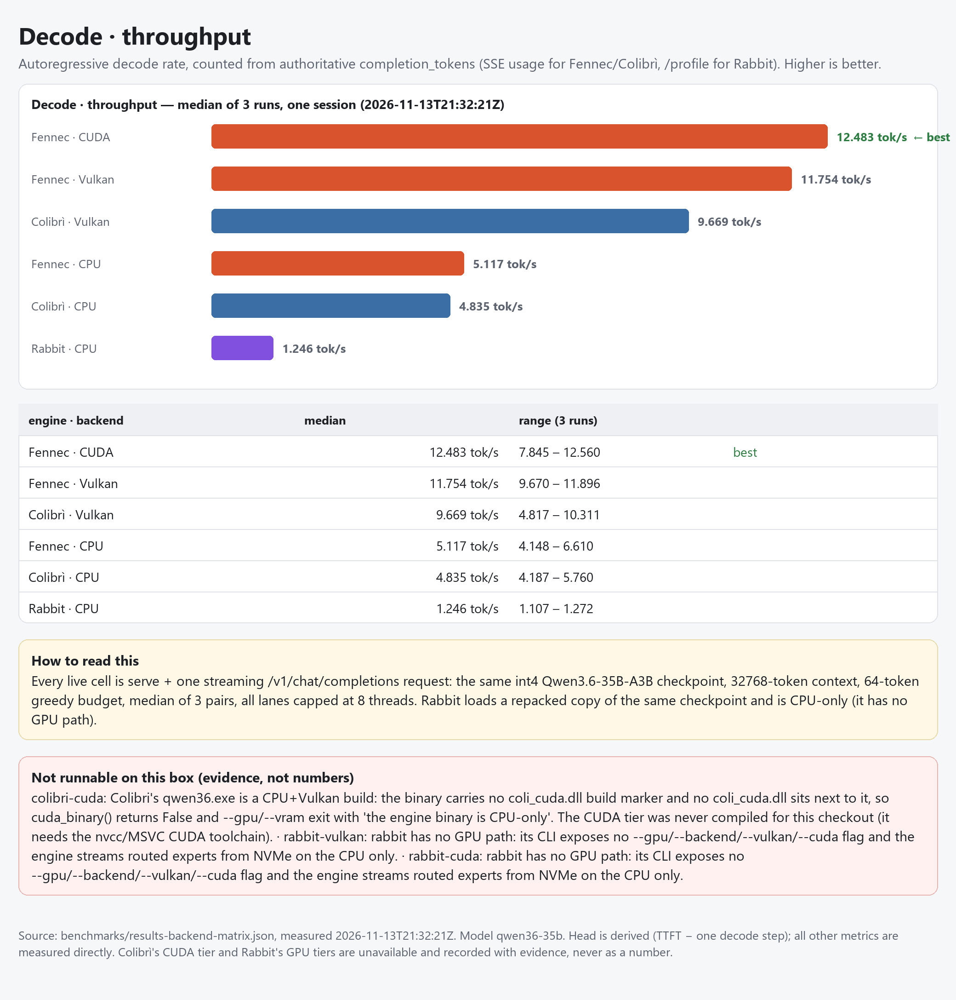
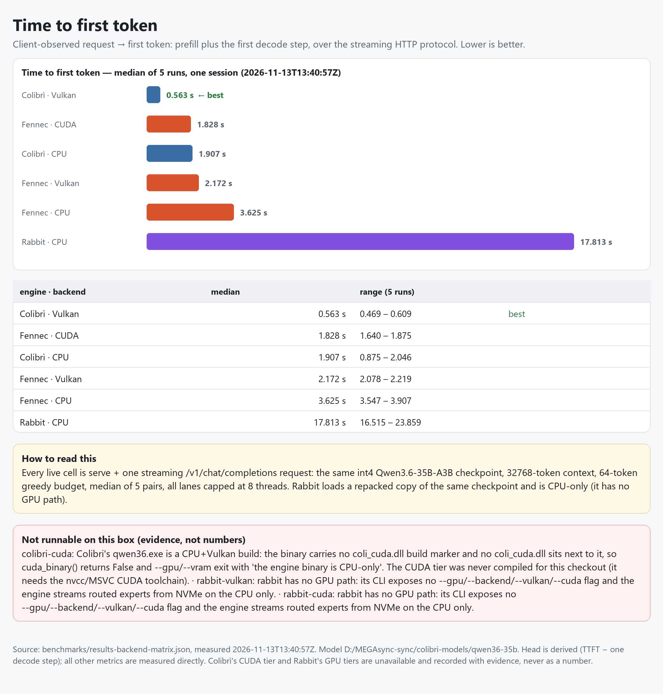
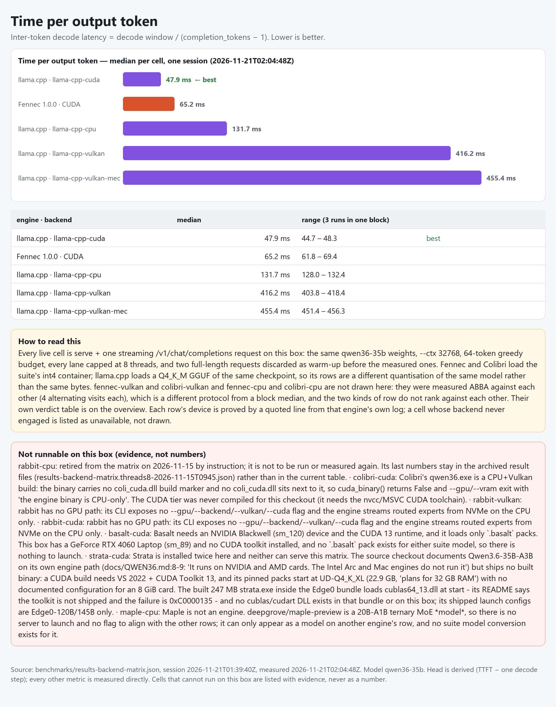
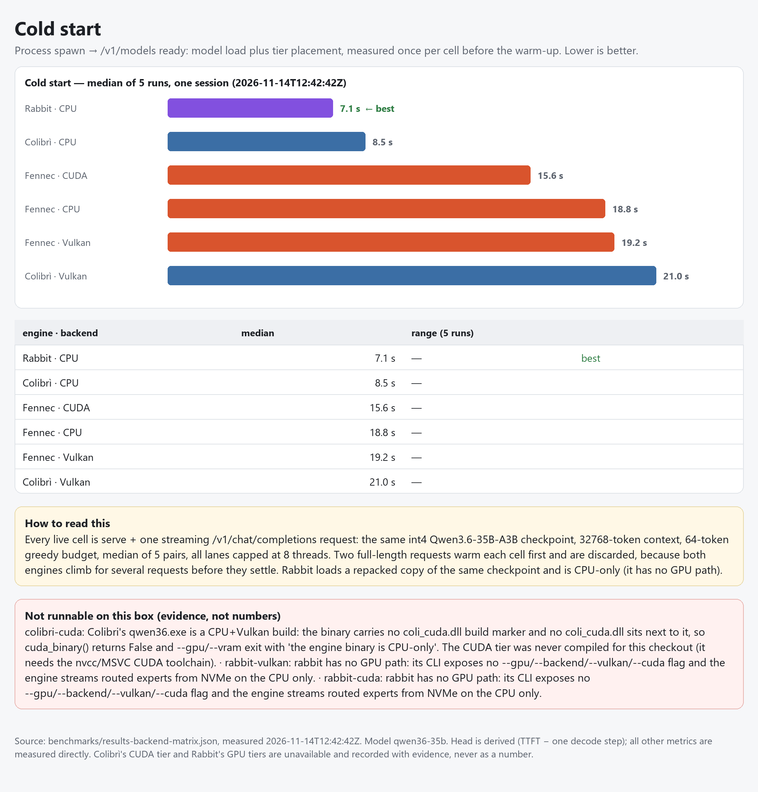

**A high-performance LLM inference engine written in Rust, supporting Qwen3.5-MoE and Edge0-145B models with Vulkan, CUDA, Metal, and ONNX Runtime backends.**

Fennec replaces multiple inference engines with one codebase: raw Vulkan through `vulkan-1.dll`, CUDA through the driver API with hand-written PTX, Metal via MoltenVK, and ONNX Runtime for portability. Features int4 quantization, four-tier expert routing (device/NPU/host/cold), batched GPU prefill with grouped expert union, and an OpenAI-compatible HTTP API.

## Features

- **Multi-backend support**: Vulkan, CUDA, Metal, ONNX Runtime, and CPU
- **Model support**: Qwen3.5-MoE (30B-A3B) and Edge0-145B architectures
- **Int4 quantization**: Hand-written quantizer with group-64 amax scaling
- **Four-tier expert routing**: Hot experts in VRAM, warm experts on NPU, system RAM, or cold on NVMe
- **Batched GPU prefill**: Grouped expert union matches Colibri's batch-union strategy (built and tested, but `serve` does not use it yet - see below)
- **Plugin architecture**: Extensible system for backends, models, tokenizers, and servers
- **OpenAI-compatible API**: `/v1/chat/completions`, `/v1/models`, streaming SSE
- **Zero-copy cold start**: Memory-mapped expert pool with borrowed nibbles
- **Cross-platform**: Windows, Linux, macOS (full suite runs in CI on all three)
- **Offline build**: No toolkit required, SPIR-V shaders checked in

## Quick Start

```bash
# Build from source
cargo build --release --offline

# Start the server with auto-tiering
fennec serve --auto-tier --model <model-dir> --host 127.0.0.1 --port 8184

# Or use CPU-only mode
fennec serve --cpu --threads 8 --model <model-dir>
```

> [!IMPORTANT]
> `--auto-tier` (or `--gpu N`) enables the device tier. Without a tier flag, the engine loads CPU-only. Use `--host` for bind address and `--host-gb` for system-RAM expert pool size. Non-loopback binds require `--allow-remote` (no TLS, model lives in RAM).

## Available Commands

```bash
fennec info      # Display model information
fennec doctor    # Check system requirements
fennec plan      # Plan expert tier placement
fennec probe     # Enumerate Vulkan/CUDA/Metal devices
fennec quant     # Quantize model to int4
fennec bench     # Run benchmarks
fennec decode    # Decode a single prompt
fennec run       # Interactive REPL
fennec serve     # Start HTTP server
fennec help      # Show help
```

## Architecture


**CPU, GPU, and NPU run concurrently.** The device tier holds hot experts in VRAM (FQ4 format over SPIR-V or PTX), the NPU tier holds warm experts in dedicated AI accelerator memory (Intel AI Boost via OpenVINO), the host pool holds warm experts in system RAM with zero-copy borrow, and cold experts stream from NVMe on demand.

The routing pipeline:
1. **Route**: Router picks top-8 of 256 experts per layer
2. **Bucket**: Picks grouped by residency (device/NPU/host/cold)
3. **Execute**: Single `VkBatch` with three barrier-free phases (gate_up → silu_mul → down)
4. **Reduce**: `moe_reduce` kernel weighted-sums top-k slots and shared expert
5. **Overlap**: NPU experts, host experts, and disk fetches run while device is busy

### Batched GPU Prefill

`Model::prefill_device` (`src/model.rs:4510`) runs a chunk of prompt tokens through the
layers in batches, so a weight block is read once for the chunk instead of once per token:

- **Batched operations** (GPU): RMSNorm, AXPY residual, GDN projections (5× per layer),
  Attention projections (4× per layer) - the five `*_batch.comp` shaders
- **Pick-level expert union**: every pick in the chunk is classified on its own
  (`MoeLayer::prefill_device_grouped`, `src/model.rs:1722`) - a VRAM-resident pick records
  once into the device wave, a host-pool pick joins one batch-union run across the worker
  pool, a cold pick streams. The first version unioned by *token*, so any token with one
  device pick ran its whole expert chain alone inside the chunk and paid for both.
- **Served on CUDA**: the device arm of the `let batched` gate in `src/serve.rs` is
  `Model::prefill_device_chunked` (`src/model.rs:4540`), which says CUDA. Chunking there
  beat the per-token device loop by 8.1-8.4 ms per prompt token at 34, 126 and 531 tokens,
  both orders at every length. The host tier batches through `Model::prefill` on any
  backend.
- **Not served on Vulkan**: the same script, same binary, `--backend vulkan`, at the
  served 34-token prompt read 1.845 s per-token against 2.779 s chunked - 27.5 ms per
  prompt token *slower*, +0.730 s in one order and +0.987 s in the other, decode step
  unmoved at 68.6 against 69.1 ms/token. That tier keeps the per-token path.
- **Why the two tiers disagree is not measured.** Something the chunk does through SPIR-V
  costs what the same work does not cost through the CUDA driver, and no stage counter
  separates them yet. Both arms come from `engine-bench/ab/prefill201-picklevel-ab.py`,
  which is the instrument to re-run once there is a hypothesis worth pricing.

## Performance

Every number in this section comes from **one box**: RTX 4060 Laptop + Core Ultra 7 155H,
21-22 GB free, every lane capped at 8 threads, 32768-token context, 64-token greedy
budget, `serve` plus one streaming `/v1/chat/completions` request per visit, two
full-length requests discarded as warm-up before any median. Model `qwen36-35b`
(22.78 GiB, 43 int4-packed shards). Each row names the session it was measured in, and a
verdict is only ever drawn inside one session: two rows from different sessions are
levels, not a ranking of each other. The table is generated from the session files:
`python benchmarks/results.py sync` rewrites it, so typing a number into it changes
nothing.

Two protocols appear here and they answer different questions:

- **ABBA paired** - Fennec and one comparator alternate inside the session, four
  rounds, both orders. This puts the box's own drift inside the gap being measured:
  the same unchanged binary has read 85.1 ms/token in one block session and 121.3 in
  another. A lane names a winner only when the `ab` and `ba` orders land on the same
  side; when they disagree, the verdict is parity.
- **Block** - each engine measured back to back in its own half of the session. Block
  rows rank against other block rows and never against a paired row.

### Fennec against Colibri

<!-- fennec-results:bench -->
| Lane | Session | Fennec | Comparator | Result |
|---|---|---|---|---|
| CPU decode | `2026-11-21T01:39:40Z` | **143.6 ms/token** | Colibri 169.4 ms/token | **Fennec faster** - 15.2% median gap against a 14.6% run-to-run spread, ahead in 4 of 4 paired rounds |
| Vulkan decode | `2026-11-21T20:22:21Z` | **67.6 ms/token** | Colibri 58.4 ms/token | **behind** - 15.7% median gap against a 5.0% run-to-run spread, 4 of 4 paired rounds to Colibri; coverage is counted now, and it does not carry this gap. The harness snapshots each engine's expert counters per visit: Fennec answers a median of 20,514 of 31,040 routed picks on the card (66.1%, `results-backend-matrix.vulkan-experts-2026-11-21T2122Z.json`; 66.4% in the paired session below), where Colibri's log accounts `device 23503 of 33600 routed experts (69.9%)`. Each engine counts its own turn, so the percentages compare and the counts do not - and #486 priced the points instead of allocating the host bill to them: one binary, four device budgets, 1,597 slots against 1,230 (7.7 coverage points) worth 0.254 ms/token, orders disagreeing, inside that session's own 2.23 ms reference-arm spread (benchmarks/artifacts/raw/ab-2026-11-21-devbudget-vulkan/). So the 3.5 points between these engines cost under 0.3 ms, and #471 (the int8 trunk Colibri buys slots with: `362 matrices resident, 1863.9 MiB; placed int8 291` against Fennec's f16 `dense 68.2 MiB/layer`) is worth doing for the smaller trunk reads (#470), never for the coverage. The direct proof: three Fennec builds in ONE session. The Vulkan int4 gemv rewrite (`b4715b4`) is worth +18.341 ms/token over the commit before it (`e4d0ec9`) - 4 of 4 rounds, both orders agreed, pick counts 8 apart out of 31,040 - and the 35 commits after it -0.246 ms, split 2 of 2 (benchmarks/artifacts/raw/ab-2026-11-21-gemvq4-vulkan/; the 41-commit pair, 67.460 against 81.841, is in ab-2026-11-21-binaries-vulkan/). Nor is it the card the plan committed (#460), which #486 prices at 0.254 ms for 367 slots. Both retire this row's other candidate, that Fennec fell 17.9% since the 57.302 session: that tree already carried the kernel - its own artifact says `postkernel`, committed 3h18m later - and it reads 65.8-68.9 today. What is left is per-pass cost and concurrency: Colibri hides its host lane (`waited 123.3 ms (91% of device time hidden)`) while Fennec's plan bills 14.31 ms of cpu lane with 1.19 ms of it concurrent (#437), and the kernels underneath both lanes are the Vulkan f16 gemv and f32 GDN residual of #472. |
| Served time to first token (device tier) | `2026-11-21T20:22:21Z` | **1.992 s** | Colibri 0.797 s | **behind** - 149.9% median gap against a 9.7% run-to-run spread, 4 of 4 paired rounds to Colibri; the prompt still goes through this tier one token at a time, and that is a measured choice: the batched device chunk served on CUDA (8.1-8.4 ms off every prompt token at 34, 126 and 531 tokens, both orders) lost the identical run on Vulkan by 27.5 ms per prompt token at the served length, +0.730 s in one order and +0.987 s in the other, with its decode step unmoved (benchmarks/artifacts/raw/ab-2026-11-21-prefill-201-vulkan/picklevel.json), so `Model::prefill_device_chunked` answers CUDA and not the tier test. Colibri instead runs the prompt as one batched step - its log says `a step of 36 rows` for a 36-token prompt - so each expert it reads serves the whole prompt. Why the chunk pays on SPIR-V what it does not pay through the CUDA driver is not measured. |
| CUDA decode vs Strata (ctx 8192) | `2026-11-21T20:53:29Z` | **58.9 ms/token** | Strata 38.6 ms/token | **parity, not a win** - 52.7% gap sits inside the 58.6% spread of the same pair (0/4 rounds to Fennec); the gap left after speculation is per-pass cost. #481 priced Strata's drafter at 1.53x - the cell that changed nothing but `--mtp` measured 23.81 ms/token with it and 36.46 without (engine-bench/raw/strata-mtp-attribution.json) - and the drafter is on in this row (`drafts accepted 43 of 44 (length)`, Strata's own accounting), yet the paired cell reads 38.6 ms/token against Fennec's 58.9, i.e. its un-speculated level, over four visits spread 29.5 to 52.3. What is on the table is therefore the host expert read #464 found issue-limited rather than bandwidth-limited, plus a draft block Fennec's own checkpoint already carries unread - 529 `mtp.*` tensors, 0.50 GiB, `mtp_num_hidden_layers: 1` - that no code path uses (#482). Two disclosures: every Strata token came back in `reasoning_content` instead of the answer field, and it needed a `` chat-template pack plus 81.3 s of cold start against Fennec's 28.5 s. The attribution cell ran alone while this row is paired, so its ratio travels and its levels do not. |
| CUDA decode vs llama.cpp | `2026-11-21T01:39:40Z` | **65.2 ms/token** | llama.cpp 47.9 ms/token | both rows are block medians of the same session, so this is a level difference and not an ABBA verdict; llama.cpp reads a Q4_K_M GGUF of the checkpoint while Fennec reads the suite's int4 container, which is the first thing to hold constant before calling it a kernel gap (open as task #459) |

Every row is re-derived from the ABBA session file it names; the medians are the median of paired visits after two discarded full-length warm-ups, and the spread is the run-to-run range of the same pair on this box. Sources: `results-backend-matrix.abba-2026-11-15T0941Z.json`, `results-backend-matrix.abba-vulkan-postkernel-2026-11-15T1047Z.json`, `results-backend-matrix.abba-2026-11-21T0139Z.json`, `results-backend-matrix.abba-2026-11-21T1655Z.json`, `results-backend-matrix.blocked-2026-11-21T1830Z.json`, `results-backend-matrix.abba-vulkan-tokengate-2026-11-21T2022Z.json`, `results-backend-matrix.abba-cuda-chunk-2026-11-21T2053Z.json`.
<!-- /fennec-results:bench -->

### Fennec against llama.cpp 1.0.0

llama.cpp is one of three engines measured here that beat Fennec on at least one lane
(the other two are Strata on CUDA and, in the paired row above, Colibri on Vulkan), and
it does it on CUDA: **47.9 ms/token against Fennec's 65.2** in the same session. That is a level
difference between two block rows, not a verdict, and the two engines are not reading
the same bytes - llama.cpp loads a Q4_K_M GGUF of the checkpoint while Fennec loads
the suite's int4 container. Holding that constant is the first step of the open CUDA
task; the second is llama.cpp's `-cmoe` device-expert cache, whose variant measured here
(`-ngl 99 -cmoe --moe-cache-mib 3584`) produced a 455.4 ms/token Vulkan row against plain
auto-placed llama.cpp's 416.2 in the same session, so it bought nothing on this card and
#461 closed it without porting. The gap is not one run's drift: the earlier block session
`2026-11-21T01:20:01Z` on the same box read llama.cpp 45.9 against Fennec 61.3 ms/token,
two block rows again, and that table survives in
`engine-bench/logs/session-2026-11-21T0220.log`.

On the lane where both engines take the same weights through their own auto planner,
llama.cpp's Vulkan rows are far behind Fennec because its fitter put 14.4 GiB of the
model in `CPU_Mapped` and left 5.2 GiB on the card: 416.2 and 455.4 ms/token against
Fennec's 66.0. That pair is not the same protocol either (Fennec's Vulkan row is a
paired median, llama.cpp's are block medians), so it is quoted as a level difference
and not an ABBA verdict - a 6x gap is well outside what the protocol distinction moved
anywhere else in this session. The same caution rules the CPU lane: llama.cpp's
block row of `2026-11-21T01:39:40Z` reads 131.7 ms/token against Fennec's paired
143.6, and because the two are different protocols that lane is recorded as unmeasured
rather than as a tie.











Each row's device is proved by a line quoted from that engine's own log, and the
llama.cpp rows quote the memory split from a `-lv 4` run of the same argv on the same
box - a placement captured with a different amount of free memory is a different
statement, so the free-RAM figure is printed beside it.

### Cells with no number

A missing column is not a tie. These were attempted and could not run on this box:

- **rabbit** - retired from the matrix by instruction on 2026-11-15; its last rows
  stay in the archived session files and are never quoted as current.
- **Colibri on CUDA** - its `qwen36.exe` carries no `coli_cuda.dll`, so `--gpu` exits
  with "the engine binary is CPU-only". Building that tier needs nvcc and an MSVC
  host compiler, neither of which is installed.
- **Basalt** - needs an NVIDIA Blackwell (sm_120) device, the CUDA 13 runtime and
  `.basalt` packs. This box has sm_89 and no pack exists for either suite model.
- **Strata** - its `strata.exe` loads `cublas64_13.dll` at start and dies with
  0xC0000135 without VS 2022 + CUDA Toolkit 13; its shipped launch configs are
  Edge0-120B/145B only.
- **Maple** - `deepgrove/maple-preview` is a 20B-A1B ternary MoE *model*, not an
  engine: there is no server to launch and no flag to align with the other rows.

### Still open, measured

- **Served time to first token trails Colibri on the Vulkan tier** (the `loss` row in
  the table above). The batched device prompt is now wired into `serve` and served where
  it won: CUDA took 8.1-8.4 ms off every prompt token at 34, 126 and 531 tokens, both
  orders. Vulkan refused the same chunk in the same script - 27.5 ms per prompt token
  *slower* at the served length, both orders - so its gate stays on the per-token loop,
  and that loop pays a full expert read per prompt token. Colibri does not: its own log
  describes the prompt as one step of 36 rows, so the weight it reads serves 36 tokens.
  **Why the chunk costs time on SPIR-V and buys it through the CUDA driver is not
  measured** - that is the open question, and the next TTFT lever on this tier.
- **The CUDA decode deficit against llama.cpp**, described above.
- **Kernel headroom on Vulkan**: the device-timing probe
  `tests/gpu.rs::mixer_kernel_shapes` - `#[ignore]`d, so it runs under
  `cargo test --release --offline --test gpu -- --ignored`, and it prints rather than
  asserts, so these are one run's levels rather than a fixed pair - read 1134.1 us for
  one GDN layer's mixer as seven separate dispatches against 446.4 us as one
  barrier-free submit on 2026-11-15. Across the 30 GDN layers in a token that is 35.4 ms
  against 13.4 ms.

> [!NOTE]
> Quote the paired per-round result, never a level carried over from another session,
> and never rank a block row against a paired row. CUDA requires NVIDIA drivers;
> Vulkan works on any compatible GPU; CPU mode uses AVX2 int4 and int8 kernels.

## Hardware Support

| Device | Status | Notes |
|--------|--------|-------|
| **NVIDIA** | ✅ Measured | Vulkan 1.4+ and CUDA, compute capability 8.9+ |
| **AMD** | ✅ Supported | Same Vulkan code path, no vendor extensions |
| **Apple Silicon** | ✅ Compile-verified | Metal via MoltenVK, SPIR-V runs unchanged |
| **Intel Arc iGPU** | ✅ Enumerated | Ranked below dGPU by planner |
| **Intel NPU** | ✅ OpenVINO | DirectML refused, OpenVINO measured working |
| **CPU** | ✅ Measured | AVX2 int4, 22+ logical cores |

### Backend Selection

Backend choice is automatic by vendor, and overridable:

```bash
# Automatic: NVIDIA → CUDA, Apple → Metal, others → Vulkan
fennec serve --auto-tier --model <model-dir>

# Explicit backend
fennec serve --backend vulkan --gpu 0 --model <model-dir>
fennec serve --backend cuda --gpu 0 --model <model-dir>
fennec serve --backend ort --model <model-dir>  # ONNX Runtime
fennec serve --cpu --model <model-dir>          # CPU-only
```

## ONNX Runtime Integration

ORT runs dense F16 projections (lm_head, delta-net, attention, shared expert, router gate) as ONNX MatMul graphs on accelerators without hand-written kernels. The int4 routed experts and four-tier residency stay on Fennec's own kernels.

```bash
# Use ORT backend for portability
fennec serve --backend ort --model <model-dir>
```

> [!IMPORTANT]
> ORT is integrated for portability, not as a competing engine. The lm_head and dense projections become MatMul sessions; routed experts remain on Fennec's kernels.

## Testing

```bash
# Run all tests (203 passing)
cargo test --release --offline

# Backend-specific tests
FENNEC_BACKEND=cuda cargo test --release --offline --test gpu
FENNEC_BACKEND=vulkan cargo test --release --offline --test gpu

# Golden tests against transformers reference
FENNEC_GOLDEN_MODEL=<model-dir> cargo test --release --offline --test golden

# HTTP contract tests
python tools/smoke_serve.py  # 30 checks against running server
```

**Test coverage**: 203 passed, 0 failed, 5 ignored across 10 suites
- `src/` unit tests: quantizer, kernels, auth, samplers, device discovery, memory
- golden tests against the pinned transformers 5.22.2 reference (`tests/golden.rs`)
- device-vs-CPU integration tests (`tests/gpu.rs`, run once per backend)
- tokenizer, dense-lane and Edge0-harness tests (`tests/tokenizer.rs`, `tests/dense.rs`,
  `tests/dense_i8.rs`, `tests/edge0_bench.rs`)

The per-suite split is whatever the run above prints; the total, the ignored count and
the suite count come from `benchmarks/artifacts/hub/RESULTS.json` in the suite checkout, and
`python benchmarks/results.py sync` rewrites the line above from it.

CI runs the whole suite on Windows, macOS (ARM64) and Ubuntu x86_64. The golden
bands follow the kernel that produced them: `kernel::dot` reduces in 8 AVX2 lanes
+ a tree on x86 and serially elsewhere, so the two accumulate f32 in different
orders and the tight bit-level assertions branch on that feature guard rather
than assuming x86.

> [!WARNING]
> Setting `FENNEC_GOLDEN_MODEL` widens tolerance bands to 3e-2 / 2.5e-1. A forward-slash directory spelling also widens bands due to string matching. Don't read a widened run as a tight pass.

## Build Requirements

- **Rust**: Edition 2021, stable toolchain
- **Vulkan**: SDK not required (SPIR-V shaders checked in)
- **CUDA**: Driver API only (no toolkit, PTX kernels checked in)
- **Platform**: Windows, Linux, macOS

```bash
# Offline build (no network required)
cargo build --release --offline -j 6

# With ORT backend
cargo build --release --features ort --offline
```

## API Endpoints

### HTTP Server

```bash
# Start server
fennec serve --auto-tier --model <model-dir> --host 127.0.0.1 --port 8184
```

**Endpoints**:
- `GET /health` — Health check (requires bearer auth)
- `GET /v1/models` — List available models
- `GET /metrics` — Prometheus metrics
- `GET /experts` — Expert routing statistics
- `GET /profile` — Profiling data
- `POST /v1/chat/completions` — Chat completion (JSON or SSE)
- `POST /api/generate` — Text generation (JSON or NDJSON)

All endpoints require bearer authentication. Loopback by default; use `--allow-remote` for network access (no TLS).

### Example Request

```bash
curl http://127.0.0.1:8184/v1/chat/completions \
  -H "Authorization: Bearer YOUR_API_KEY" \
  -H "Content-Type: application/json" \
  -d '{
    "model": "qwen3.5-moe",
    "messages": [{"role": "user", "content": "Hello"}],
    "max_tokens": 64,
    "stream": false
  }'
```

## Tokenizer

Fennec includes a BPE tokenizer id-for-id identical to Hugging Face:

- **Pipeline**: NFC → Split (Qwen pattern via `fancy-regex`) → ByteLevel with `use_regex: false`
- **Vocabulary**: 247,587 merges, 248,044 vocab, 26 added tokens
- **Stop tokens**: From `generation_config.json` (authoritative)
- **Sampling**: Greedy, top-k, nucleus, temperature, seeded splitmix64

## Known Limitations

> [!CAUTION]
> - **Planner optimism**: Bytes-only pricing doesn't model DRAM-resident expert compute
> - **CUDA moe_reduce**: CUDA path lacks phase-batched `moe_reduce` kernel (uses per-expert chain)
> - **Apple Metal**: Compile-verified but not performance-measured
> - **NPU DirectML**: Refused by driver; use OpenVINO backend instead
> - **Chat template**: Missing think opener (Colibri emits `\n\n`, Fennec emits nothing)
> - **Served device prefill**: the batched device path is served on CUDA and withheld on Vulkan, where the same paired run measured it 27.5 ms/prompt-token slower; Vulkan device TTFT therefore trails Colibri (see Performance)

## Project Structure

```
fennec/
├── src/
│   ├── main.rs          # CLI entry point
│   ├── model.rs         # Model loading and inference
│   ├── gpu.rs           # Vulkan GPU backend
│   ├── cuda.rs          # CUDA backend
│   ├── quant.rs         # Int4 quantization
│   ├── sched.rs         # Expert tier planner
│   ├── serve.rs         # HTTP server
│   ├── tokenizer.rs     # BPE tokenizer
│   └── shaders/         # SPIR-V compute shaders
├── tools/
│   ├── smoke_serve.py   # HTTP contract tests
│   └── shaders.sh       # Shader compiler
└── docs/                # Documentation and benchmarks
```

## Acknowledgments

Fennec builds on ideas and code from:

- **[rabbit](https://github.com/ferrumox/rabbit)**: Int4 layout (group-64 amax/7, low-nibble-first two's complement)
- **[Colibri](https://github.com/JustVugg/colibri)**: Three-tier usage-ranked placement, `.coli_usage` router histogram, `COLI_*` environment, `serve` contract
- **[fox](https://github.com/ferrumox/fox)**: Map-don't-copy cold start, Rust front-end over Vulkan device tier

## License

MIT License - see LICENSE file for details.

## Version

**1.0.0** - the working version in `Cargo.toml`. Nothing at 1.0.0 has been published:
this repo carries no tags and no releases, and the published Fennec ladder (`v0.1.0` …
`v0.9.0`, newest 2026-11-11T19:29Z) lives in the nine suite repos. The test count above
is generated from the suite's results hub, so it is the current run of
`cargo test --release --offline` on this tree rather than a remembered one.
