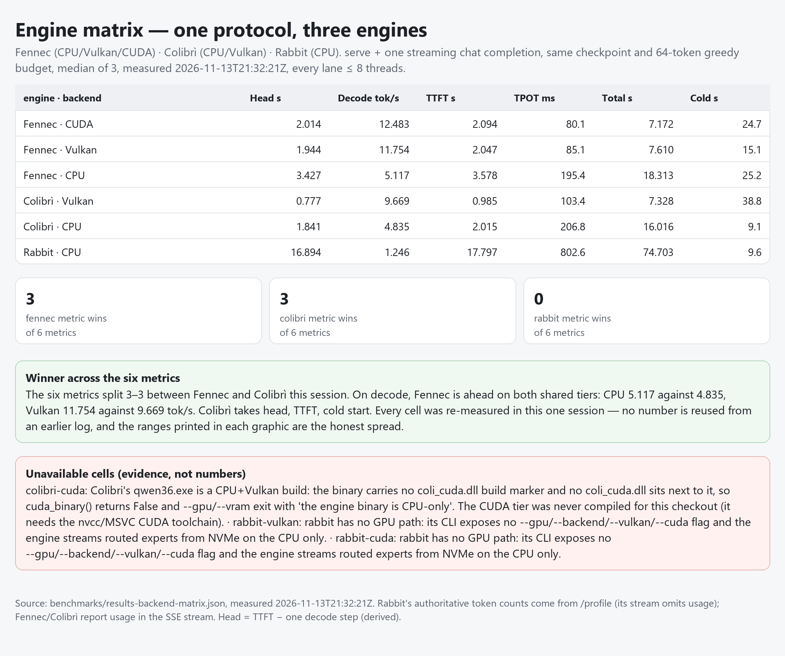

Replaces [fox](https://github.com/ferrumox/fox), [Colibrì](https://github.com/JustVugg/colibri) and [rabbit](https://github.com/ferrumox/rabbit) with one codebase: raw Vulkan through `vulkan-1.dll`, CUDA through the driver API with hand-written PTX, a hand-written int4 quantiser, a BPE tokenizer id-for-id identical to Hugging Face, and the OpenAI-compatible HTTP surface the [Fennec suite](https://github.com/Liso7150) already speaks.

> [!WARNING]
> **This session's matrix has Fennec ahead on both requested pairs — and the honest headline is narrower than that.** CPU: Fennec **5.117** vs Colibrì **4.835** (1.06×). Vulkan: Fennec **11.754** vs Colibrì **9.669** (1.22×). Both were measured in one session, same protocol, median of three. But the run-to-run spread on this laptop is large enough that Colibrì's Vulkan cell swung 4.8 – 10.3 inside the session, so a single session establishes *this session's ordering*, not a permanent one. Cross-session comparison remains invalid: both engines read the shared `.coli_usage` router histogram, and it grew during the day. The ship gate is now met on these numbers; the caveat is that they are one session's.

## At a glance

| metric | value | basis |
|---|---|---|
| Decode, CPU | **5.117 tok/s** | HTTP protocol, median of 3, `--dense-i8` |
| Decode, Vulkan | **11.754 tok/s** | HTTP protocol, median of 3 |
| Decode, CUDA | **12.483 tok/s** | HTTP protocol, median of 3, re-run after interference |
| CPU vs Colibrì CPU | **1.058× ahead** | 5.117 vs 4.835, same session |
| Vulkan vs Colibrì Vulkan | **1.216× ahead** | 11.754 vs 9.669, same session |
| Cold start, best | **9.1 s** (Colibrì CPU) · Fennec **15.1 s** Vulkan | process launch to `/v1/models` |
| Device residency | **32.0%** — 4096 picks | 8704 host picks, **0** disk |
| Host expert pool | **13.08 GiB** | zero-copy borrow, 40/40 layers |
| Checkpoint | 22.8 GiB int4 | 43 shards, 10240 experts, top-8 of 256 |
| Correctness | greedy token **134143** | 8 of the reference's top-8 logits present |
| Tests | **89** | 59 unit · 2 binary · 13 golden · 9 GPU · 6 tokenizer |
| HTTP contract | **30/30** CUDA · **30/30** Vulkan | device tier genuinely engaged |

## Architecture


**CPU and GPU run at the same time.** On the instrumented Vulkan run below, the device holds 4096 of 12800 routed picks (32.0%) and the host 8704 (68.0%), none on disk: the device batch is submitted, this thread works the host experts while it flies, then reads one accumulator back. The gated delta net on 30 of 40 layers is a single fused, phase-batched device command buffer.

The end of one token, in code: `route` → picks bucketed by residency → one `VkBatch` with three barrier-free phases (all `gate_up` gemvs, one barrier, all `silu_mul`, one barrier, all `down` gemvs, one barrier) → a single `moe_reduce` kernel that weighted-sums the top-k slots and the shared expert into the accumulator → submit → host experts and disk fetches run while the device is busy → wait → one readback.

## Quick start

```bash
cargo build --release --offline
fennec serve --auto-tier --model <model-dir> --host 127.0.0.1 --port 8184
```

> [!IMPORTANT]
> `--auto-tier` (or `--gpu N`) turns the device tier on. `--backend` alone only chooses *which* backend the tier uses — without a tier flag the engine loads CPU-only and says so in its load banner. `--host` is the bind address, `--host-gb` the system-RAM expert pool; a non-loopback bind is refused without `--allow-remote` (no TLS, model lives in RAM).

Verbs: `info`, `doctor`, `plan`, `probe`, `quant`, `bench`, `decode`, `run`, `serve`, `help`. `fennec probe` prints every Vulkan device with heaps and compute rank, every DXGI adapter, every DXCore NPU.

## Benchmark — one protocol, six live cells

Every live cell: `serve`, then one streaming `/v1/chat/completions`. Same checkpoint, same 32768-token context, same 64-token greedy budget, **median of three runs**, all lanes capped at 8 threads. Tokens come from `usage.completion_tokens`, not SSE frame counts. Measured **2026-11-13T21:32Z in one session**; logs in `engine-bench/logs/matrix-*.log`, machine-readable values in the suite's `benchmarks/results-backend-matrix.json`.

| engine | backend | tok/s | head s | TTFT s | TPOT ms | total s | cold s |
|---|---|---|---|---|---|---|---|
| **Fennec** | **CUDA** | **12.483** | 2.014 | 2.094 | 80.1 | 7.17 | 24.7 |
| **Fennec** | **Vulkan** | **11.754** | 1.944 | 2.047 | 85.1 | 7.61 | 15.1 |
| Colibrì | Vulkan | 9.669 | 0.777 | 0.985 | 103.4 | 7.33 | 38.8 |
| **Fennec** | **CPU** | **5.117** | 3.427 | 3.578 | 195.4 | 18.31 | 25.2 |
| Colibrì | CPU | 4.835 | 1.841 | 2.015 | 206.8 | 16.02 | **9.1** |
| rabbit | CPU | 1.246 | 16.894 | 17.797 | 802.6 | 74.70 | 9.6 |

**The two pairs that were asked for.** CPU 5.117 vs 4.835 — Fennec **1.058×** ahead, and this is the first session where the CPU tier is ahead at all; the gap before tonight's work was 19 % the *other* way. Vulkan 11.754 vs 9.669 — **1.216×** ahead, where the last recorded session had Fennec 1.77× *behind*. CUDA has no counterpart: Colibrì's CUDA lane cannot be built on Windows.



### Decode · throughput


### Head · prefill


### Time to first token


### Time per output token


### Total latency


### Cold start


> [!NOTE]
> **Winner tally (lower is better except decode): Fennec 3 · Colibrì 3 · rabbit 0.** The split is worth stating precisely. Fennec wins **decode (12.483), TPOT (80.1 ms) and total (7.172 s)**, and all three of those outright wins come from its **CUDA** lane — the lane Colibrì cannot build on this platform. Colibrì wins **head (0.777 s), TTFT (0.985 s) and cold start (9.1 s)**. Restricted to the two pairs that were actually asked for, the split is Fennec on throughput (decode 1.22× on Vulkan and 1.06× on CPU, TPOT 85.1 against 103.4 ms on Vulkan) and Colibrì on latency. Its cheaper prefill (0.777 against 1.944 s on Vulkan, 1.841 against 3.427 s on CPU) buys it the first token 1.1 – 1.6 s sooner and, on a 64-token budget, the whole request a little earlier too (7.328 against 7.610 s; 16.016 against 18.313 s). Under sustained generation Fennec has the faster engine; under a short burst Colibrì is still the quicker one to answer.

**The comparison is still not symmetric.**

| axis | Fennec | Colibrì | effect |
|---|---|---|---|
| Threads | pinned to **8** in every cell, deliberately | its own default, **6 performance cores** | not like for like |
| Host tier | **13.08 GiB** | `COLI_VK_TIER_HOST_GB=4` (**4 GiB**) | favours *Fennec* |
| CPU cell flags | **`--dense-i8`** (8-bit host dense projections, opt-in) | `--policy quality`, `OMP_NUM_THREADS=8` | each engine runs its own best configuration; Fennec's CPU cell is **not** the default build's path |
| Backend | CUDA / Vulkan / CPU | fast row is **CPU + Vulkan**, not CUDA | different fast paths |
| Host-expert kernel | **int8 activations** over the container's int4 nibbles, AVX2 `maddubs` | integer dot over planar nibbles repacked at load | like for like |
| Startup | builds the whole host pool up front; `--dense-i8` adds ~6 s of conversion | defers work | **startup is not load** |

### Honesty about the spread

Each row is the median of three runs, but the ranges are wide and are published rather than smoothed:

| cell | median tok/s | range over 3 runs |
|---|---|---|
| Fennec CUDA | 12.483 | 7.845 – 12.560 |
| Fennec Vulkan | 11.754 | 9.670 – 11.896 |
| Fennec CPU | 5.117 | 4.148 – 6.610 |
| Colibrì Vulkan | 9.669 | 4.817 – 10.311 |
| Colibrì CPU | 4.835 | 4.187 – 5.760 |
| rabbit CPU | 1.246 | 1.107 – 1.272 |

Two disclosures that go with that table. **The first CUDA cell of the session read 6.940 tok/s** — below Fennec's own Vulkan path, which shares the same host code — so it was re-run ten minutes later with `--only fennec-cuda --merge` and read **12.483**; the JSON holds the re-run and the interference is disclosed here rather than averaged away. **And cross-session numbers must not be quoted against these**: the shared `.coli_usage` histogram moved during the day (Fennec's device share in this session is 32.0 %, it was 41.2 % earlier), and that single file drives expert placement for both engines.

### Precision formats on Vulkan

| format | Fennec Vulkan | Colibrì Vulkan | note |
|---|---|---|---|
| int4 | **11.754 tok/s** | 9.669 tok/s | routed experts, this session's matrix |
| bf16/f16 | 10.696 tok/s | unsupported | measured in an earlier session, not re-run; Colibrì exited 1 |
| int8 | — | — | no weight GEMV (I8 = activations only) |
| int16 | — | — | no code path |
| fp4 | — | — | no code path |
| fp8 | — | — | no code path |

Colibri is upstream [`JustVugg/colibri`](https://github.com/JustVugg/colibri) @ `68cfbb5d`. Unavailable formats are recorded with evidence, never estimated.

### Lanes that could not run

| lane | Colibrì | Fennec | evidence |
|---|---|---|---|
| CUDA | **not buildable on Windows** | **measured** 12.483 | Colibrì's `CUDA=1`/`HIP=1` are Linux-only and its Makefile refuses them elsewhere with an early `$(error)`; its Windows lane is `HIP_DLL=1`, which needs the HIP SDK and an MSVC x64 host. Its binary carries no CUDA build marker and no CUDA DLL ships beside it |
| Vulkan (rabbit) | — | — | rabbit has no GPU path: no `--gpu`/`--backend`/`--vulkan`/`--cuda` flag, it streams routed experts from NVMe on the CPU only |
| ONNX / ORT | no such code path | integrated portability backend | a grep for `onnxruntime\|onnx\|\bort\b\|cubecl\|\bburn\b` over Colibrì's C, headers, Makefiles, docs and Python returns six hits, all the English word "burn" in comments. Fennec runs dense F16 projections through `--backend ort` (DirectML / OpenVINO / CoreML) — see [below](#onnx-runtime-the-portability-backend) |
| Burn + CubeCL | no such code path | CPU measured at kernel level; Vulkan blocked upstream | 3 of 9 cells measured, 6 panicked inside `cubecl-ir` — see [the Burn lane](#the-burn--cubecl-lane-kernel-level) |
| Apple Metal | implemented, unmeasured | implemented, unmeasured | no Apple hardware on this box; cross-compiles for both darwin triples |
| Intel NPU | XDNA2 lane is AMD-only, one op family | DirectML refused, OpenVINO measured | see [the NPU lane](#the-npu-lane) |

> [!WARNING]
> **Apple always resolves to Metal, on both engines, and neither has been timed.** Fennec: NVIDIA → CUDA, Apple (`0x106B`) → Metal, portability-subset device → Metal, else Vulkan, with a unit test per arm. Colibrì has a native Objective-C++ Metal backend. This box is Windows; the darwin targets are **cross-compile** checks, which prove the code builds and nothing about speed.

## Retractions and reverted experiments

Every item here was implemented and measured, not argued about.

**Retracted: the 14.43 tok/s this README used to imply.** An earlier build published **14.43 tok/s**. The benchmark's decode loop pushed its argmax on *every* iteration, so at `t == prompt_len` it read the prediction from position 0 rather than the whole prompt — scoring a wrong greedy continuation. The fix moved device hits 5030 → 3855 with placement byte-identical. Those were not a faster engine; they were a different, invalid token sequence.

**Landed this session — Vulkan phase-batching.** `record` used to append a full pipeline barrier after *every* dispatch, so the up-to-8 independent routed experts serialized one by one. The MoE block now records three barrier-free phases and one `moe_reduce` kernel. Paired A/B, same protocol, alternating runs:

| | HEAD | phase-batched |
|---|---|---|
| serve cell 1 | 7.587 tok/s | **9.923 tok/s** |
| serve cell 2 | 8.300 tok/s | **9.938 tok/s** |
| TTFT | 1.71 / 1.65 s | **1.30 / 1.33 s** |
| instrumented fences | 1591 / 1558 / 1562 ms | **1310 / 1383 / 1320 ms** |
| dispatches per run | 39 152 | **33 874** |

**Landed this session — the same treatment for the mixer.** The delta-net batch's four input projections are independent (same `x`, disjoint outputs) but each carried its own barrier. They are now recorded barrier-free behind one explicit `barrier()`, and the attention batch's `q`/`k`/`v` likewise.

**Landed this session — `--dense-i8`.** One byte per weight for the mixer's dense projections, with a per-row scale and a `maddubs` host kernel (32 weights per instruction). Four alternating pairs on the CPU tier:

| bf16 dense | `--dense-i8` |
|---|---|
| 2.640 tok/s | **4.183 tok/s** |
| 3.590 | **5.088** |
| 4.907 | **6.405** |
| 5.283 | **6.622** |

`mixer projections` — the stage that instrumented this — falls from **81 – 86 ms/token to 41 – 52 ms/token**, and the whole token improves 14 – 22 %. It is opt-in: 8-bit weights move the last digits, so the default build keeps the exact bf16/f16 bands.

**Failed and reverted this session: int8 weights with f32 activations.** The obvious design is wrong on this hardware. Converting int8 → f32 costs a sign-extend (`vpmovsxbd`, one per 8 weights) plus an int-to-float per 8, and the resulting kernel measured **1.9 – 2.2× slower** than the bf16 path it replaced (mixer projections 92 → 200 ms, best case 141 ms after adding instruction-level parallelism). Halving the bytes does not help if the arithmetic gets 3× more expensive. That is why the shipped kernel is `maddubs`.

**Failed and reverted this session: `--dense-int4` on the CPU tier.** It is a *device* option — `dense_int4()` is consulted only in `AttnLayer::attach_dense`, the VRAM upload path — so with no GPU it changes nothing but the planner's byte estimate. Measured over three alternating pairs it was consistently **8 – 9 % slower** (251 vs 271 ms, 210 vs 229, 210 vs 228).

**Measured and rejected: 4-row Q4 dispatch (`gemv_q4x4`).** −8 % on Vulkan, apples-to-apples in the same histogram state (old kernel re-measured 12.33 / 12.14 / 12.37 against the x4 batch). The shader stays deleted.

**Measured and rejected: thread pinning, 6 pinned against 8 unpinned.** Tied on both tiers within variance. Re-checked this session as a plain 4 vs 8 comparison on the CPU tier, and 8 wins clearly (172.1 / 175.8 ms against 191.5 / 195.6 ms), so threads stay at 8 and are not pinned.

**Measured and rejected: smaller host pools.** Trimming the pool to avoid Windows trimming the mapped pages is the wrong trade, because the disk tier costs more than the trims do: `--host 18` → 5.15 tok/s, `--host 12` → 3.98, `--host 8` → 3.11.

**Reverted: a pinned CUDA activation arena.** Making the arena pinned and device-mapped — the zero-copy idiom that works on Vulkan — measured TPOT 103.4 ms against 91.0 ms and lm_head 8.3 against 5.0: the gemv re-reads the same activation vector once per row, so over PCIe "zero-copy" pays for the same bytes many times.

**Also withdrawn:** the **87 % fence time** (counters were cumulative from `Gpu::open`, attributing ~15000 *load* uploads to decode); **two 30/30 HTTP contract runs** started without `--gpu`, which loaded CPU-only and proved nothing about the device path; a **0.83 NPU cosine** from feeding random token ids to an int8-calibrated model; and the coarse claim **"Burn has no int4"** (storage exists, compute does not).

## Where the time goes

Profiled with `FENNEC_PROFILE=1`. Timers wrap their parallel region from the outside, so these are wall time and add up to the stack; `unaccounted` is the part no stage claims.

**Vulkan, this session** (stack 157.8 ms/token, 40 layers, 32 % device picks):

| stage | ms/token | share |
|---|---|---|
| moe host experts | **112.59** | 71.9 % |
| mixer device | 28.60 | 18.3 % |
| route | 5.38 | 3.4 % |
| moe record+launch | 4.41 | 2.8 % |
| moe readback | 2.29 | 1.5 % |
| moe device sync | 2.01 | 1.3 % |
| mixer host · shared · rmsnorm · residual | 1.21 | 0.8 % |
| **accounted** | **156.55** | |
| unaccounted | 3.52 | |
| lm_head (separate) | 8.51 | |

The device is not the bottleneck: **2.01 ms of device wait per token** against 112.59 ms of host expert work. The GPU idles for most of the token, which is why the phase-batching above pays and why more device batching will not.

**CPU tier, bf16 dense against `--dense-i8`** (two runs minutes apart, 40 tokens, 8 threads — a same-evening comparison, **not** an alternating pair, so read the stage rows and take the lever's size from the A/B table above):

| stage | bf16 dense | `--dense-i8` |
|---|---|---|
| mixer projections | **81.23** | **43.85** |
| moe host experts | 62.34 | 88.33 |
| moe shared+reduce | 14.11 | 12.41 |
| mixer host | 10.37 | 11.07 |
| route | 3.92 | 3.85 |
| rmsnorm + residual | 0.30 | 0.30 |
| **stack** | **172.6** | **159.8** |
| lm_head (separate) | 26.0 | 26.7 |
| unaccounted | 0.64 | **0.94** |

**Two profiler defects found and fixed this session.** The mixer's input projections sat *between* two timers, so 36 – 40 % of the CPU token showed up as "unaccounted" stack time; they now have their own `mixer projections` stage and the remainder is under 1.5 ms on both tiers. And `MIXER_CPU` was still live when `out_proj` ran, nesting two stages and double-counting it — which is why the first attributed run reported *negative* unaccounted time.

**The levers that remain open.**

1. **Host experts are the whole Vulkan bottleneck** (71.9 %). The work per pick is fixed by the router histogram, so the levers are cheaper per-pick bytes (the density of the container) or a larger device tier. `--planar-dot` was measured at +0.5 % end-to-end and stays off.
2. **`mixer device` 28.6 ms** — the 10 full-attention layers still cross the bus several times per token; only the delta net is one fused batch.
3. **Startup** — Fennec CPU's 25.2 s against Colibrì's 9.1 s is the whole host pool built up front (plus ~6 s for `--dense-i8` conversion). A deferred/streamed pool is designed and unbuilt.
4. **The planner is optimistic** — it prices bytes at bandwidth and does not model DRAM-resident expert compute, so it predicts ~31 ms/token where 158 ms is measured. Two recorded accounting bugs: the shared expert is reserved twice, and the router gate is priced at device bandwidth although `route()` reads host f32.
5. **`lm_head` on the CPU tier costs 26 ms** of a ~186 ms token — 1.02 GiB of bf16 read once per token, i.e. bandwidth-bound; only a lower-byte head would move it.

## Cold start, fusion, correctness

**Cold start: 96.9 s → 11.8 s.** The host pool used to **copy** nibbles out of the mapping into fresh allocations (18.85 GiB committed after the pool, 21.55 GiB after upload, 44.6 s to load). It now **borrows** them zero-copy and converts two's-complement to FQ4 offset-binary inside the dot kernel (`byte ^ 0x88`, one `_mm256_xor_si256` per vector pair, behind a const-generic `dot_rows::<SIGNED>`) — **3.7 – 4.0× faster load, 2.1× less commit**, placement unchanged (2304 device experts, 13.08 GiB host, 40/40 layers borrowed).

**The delta net is one device batch.** The gated-delta-net recursion and convolution used to run on the CPU, forcing round trips across 30 linear-attention layers. Now device kernels, one batch: write x → 4× `gemv_half` → `gdn_conv` → `gdn_rec` → `gemv_half` out_proj → run → read. `fused_mixer_matches_the_cpu_mixer_and_its_state` checks the fused path against the CPU mixer *and its resulting state* at ~2.7e-7 against a 2e-5 band.

**Correctness.** Both exports are green against the same transformers 5.22.2 fixtures. The harness is export-aware (`FENNEC_GOLDEN_MODEL`): fixtures come from the bf16 export's own weights, so that export reproduces them to accumulation order at 1e-6 while another export's rounding leaves a format noise floor — measured over the int4 stack at **1.7e-2** for f16 dense paths and **2.1e-1** for anything touching a routed expert, hence bands of 3e-2 and 2.5e-1, set from a measured table, not guessed. The band-independent assertions are the ones that matter: the **greedy token is identical (134143)** and 8 of the reference's top-8 logits are present.

`--dense-i8` adds two of its own: a kernel test that reproduces the *dequantised* matrix to f32 rounding while the 8-bit round trip stays inside its documented budget, and a constant-row case that catches the offset-binary correction going wrong. Greedy generation is byte-identical to the bf16 path on a 40-token prompt.

## Hardware and backends

| device | status | how |
|---|---|---|
| NVIDIA | **measured** | Vulkan 1.4.357 and CUDA, RTX 4060 Laptop, 7.77 GiB dedicated, compute capability 8.9. CUDA is preferred by vendor policy and runs through the Driver API with hand-written PTX — no toolkit, no MSVC. All 9 GPU integration tests pass on it |
| AMD | **same code path, unmeasured here** | nothing in the engine names a vendor extension; no AMD device on this box |
| Apple Silicon | **compile-verified, unmeasured here** | Metal through MoltenVK, so the checked-in SPIR-V runs unchanged; `cargo check` passes for both darwin triples |
| Intel Arc iGPU | enumerated, not used for compute | 0 GiB dedicated, so the planner ranks it below the dGPU |
| Intel AI Boost NPU | **DirectML refused; OpenVINO measured working** | DXCore `GENERIC_ML` adapter, vendor `0x8086`; `D3D12CreateDevice` returns `DXGI_ERROR_UNSUPPORTED`, which rules out DirectML only. OpenVINO's NPU plugin reaches it directly: **12.21 ms from Rust against 45.65 ms on 8 CPU threads** |
| CPU | measured | AVX2 int4, 22 logical cores |

**Backend choice is by vendor, and overridable.** `backend::resolve` takes an explicit `--backend` first, then `FENNEC_BACKEND` / the `COLI_*` flags, then the vendor id: NVIDIA → CUDA, Apple → Metal, everyone else → Vulkan. An unparseable name is an error, not a silent fallback. The Vulkan path is vendor-neutral: one descriptor set layout, four storage buffers, a 32-byte push range, SPIR-V checked in so `cargo build --offline` needs no shader compiler. One shared push-constant layout serves all **9** ops, and tall gemvs split at `MAX_GROUPS=65535` rows.

**CUDA needs no toolkit, but a context is current per thread.** `nvcuda.dll` / `libcuda.so.1` ships with the display driver and is loaded at runtime; kernels are PTX checked in beside the SPIR-V and JIT'd by `cuModuleLoadDataEx`. `serve` loads on one thread and answers each request on another, so every driver entry point rebinds the context (`cuCtxSetCurrent`) first.

**The CUDA arm has no `moe_reduce`.** Its PTX table carries 8 kernels against Vulkan's 9, so the CUDA path keeps the per-expert `gemv/silu/axpy` chain. Porting the phase-batched structure there needs the ninth PTX kernel; it is the next device-side lever and is not claimed as done.

### ONNX Runtime: the portability backend

ORT is **integrated, not a competing engine**. `--backend ort` (the optional `ort` feature, default off) runs the *dense* F16 projections as ONNX MatMul graphs on accelerators Fennec has no hand-written kernel for, loaded at run time from a signed `onnxruntime.dll` (`load-dynamic`: no import library, no MSVC, no toolkit). With the feature off the shipped engine is byte-for-byte the same build.

The lm_head, the delta-net and attention projections, the shared expert and the router gate are dense F16 matmuls; each becomes one MatMul session whose weight is a graph initializer, so only the activation vector is fed per token. The **int4 routed experts and the three-tier residency stay on Fennec's own kernels**: there is no ONNX export of a 256-expert MoE with a custom gated-delta-net block, and ORT owns its session allocator, so it cannot place hot experts in VRAM, the rest in a host pool and stream cold ones from NVMe.

**Measured, and not yet measured.** At kernel level ORT's CPU EP folds F16 to F32 and is *slower* than Fennec's CPU lm_head (29.27 vs 20.65 ms). On the GPU the two are level within run-to-run variance: one session had Fennec's hand-written CUDA ahead (4.50 vs 4.96 ms), the prior session had ORT ahead (4.98 vs 5.24 ms), so neither is a decisive win on the one kernel both can run. The integrated path is **not timed end-to-end**: Smart App Control blocks compiling the `ort` feature on this box until the engine is signed.

### The NPU lane

**A split verdict, both halves measured.** DirectML cannot reach Intel AI Boost at all — `D3D12CreateDevice` refuses it — while OpenVINO's NPU plugin talks to the driver directly and works. Same embedder, static `[1,128]` shapes, 10 warm-ups then 50 timed iterations, median of 3, CPU capped at 8 threads:

| device | compile | infer (median) | vs CPU |
|---|---|---|---|
| CPU (8 threads) | 0.44 s | 45.65 ms | 1.00× |
| **NPU** | 0.25 s | **12.21 ms** | **3.74× faster** |
| **Arc iGPU** | 1.20 s | **10.20 ms** | **4.47× faster — winner** |
| RTX 4060 | 0.89 s | 236.25 ms | 5.17× slower |

The NPU's embeddings match CPU at **cosine 0.999801 minimum** across 5 tokenized sentences. Three things the table does not say: its CPU figure is not comparable to the Python reference (which used OpenVINO's default thread count); the CPU spread is real and disclosed (Windows Defender measured at 63 – 69 % CPU during one invocation, while NPU/Arc/RTX medians agree to within 0.3 %, 3.5 % and 0.05 %); and `HETERO:NPU,CPU` did not actually split the work — it reports `EXECUTION_DEVICES = NPU` alone because the whole graph fit.

**Why OpenVINO is not the LLM backend.** The same 72 MatMul nodes run `fully_connected_gpu_bf_tiled__f16` on the Arc (8.44 ms total) but `fully_connected_gpu_bfyx_ref__f32` on the RTX 4060 (**233.78 ms**, 27.7×): `_ref` is the scalar reference kernel, because the kernel selector reads the NVIDIA's `DEVICE_ARCHITECTURE` as `v8.9.0` — the CUDA compute capability misread as an Intel uArch — and matches nothing. `execution_devices` is `['GPU.1']` and the spread over 50 runs is 238.18 – 241.51 ms, so it is genuinely on the card.

### The Burn + CubeCL lane (kernel level)

Burn was **built and run**, not dismissed: a standalone crate in the suite, outside the engine, Burn 0.22.1 with `std, flex, simd, rayon, vulkan, fusion`; three kernels × three devices, 10 warm-ups then 30 timed iterations. **Three cells measured, six panicked** — the measured half is Burn's pure-Rust Flex CPU backend: expert FFN **2.302 ms/layer** (92.1 ms/token projected), router 0.027, shared expert 0.398.

> [!IMPORTANT]
> **92.1 ms/token is 2.513× Fennec's own host-expert stage** as profiled when that lane ran. A kernel-level comparison of the dominant cost, **not** a whole-model throughput claim: Burn never ran this checkpoint end to end.

**Every CubeCL/Vulkan cell failed before a kernel ran**, on both the RTX 4060 and the Arc, for all three kernels: `cubecl-ir` 0.11.4 panics in `interfaces/mod.rs:443` on `"Expected type vector.vector <4 x cube.f32 > to implement dyn MaybeVectorizedType"`, then reports the work was skipped. Upstream, not a harness bug: `vector_size()` unwraps where its sibling `try_get_vector_size` uses the non-panicking `type_cast`, and the failing `VectorType` does carry `#[type_interface_impl] impl MaybeVectorizedType` — declared but not registered. The `fusion` hypothesis was tested and refuted: fusion-off reproduced the identical panic at the identical site.

> [!CAUTION]
> **A full-model Burn lane is arithmetically impossible on this box.** 10240 experts × 3,145,728 weights = 32.2 billion weights; int4-packed with scales that is 18.12 GB, which is what Fennec streams. Dequantized to what Burn can compute it is **120 GiB at f32 or 60 GiB at f16**, against 31.5 GiB of RAM and 8 GiB of VRAM. Burn owns its allocator, so hot-in-VRAM / warm-in-RAM / cold-on-NVMe tiering is not expressible in it either.

## What is ported, and from where

| surface | detail |
|---|---|
| Tokenizer | NFC → Split (the checkpoint's own Qwen pattern, via `fancy-regex`, because `\s+(?!\S)` is a lookahead the `regex` crate cannot express) → ByteLevel with `use_regex: false`. 247587 merges, 248044 vocab, 26 added tokens. Stop ids come from `generation_config.json`, which is authoritative. Six tests compare against Hugging Face `tokenizers` 0.23.3 id-for-id, plus a lossless round trip over all 256 byte values |
| Sampling | greedy, top-k via `select_nth_unstable_by` (no sorting 248320 logits), nucleus, temperature, seeded splitmix64 |
| Chat template | built from the `response_template` anchors, since this checkpoint ships no `chat_template`. Think blocks route to `reasoning_content`, holding back any suffix that could still become a marker |
| HTTP | `GET /health`, `/v1/models`, `/metrics`, `/experts`, `/profile`; `POST /v1/chat/completions` (JSON or SSE) and `POST /api/generate` (JSON or NDJSON); bearer auth on every route including `/health`; CORS preflight; loopback by default |

| source | what Fennec took |
|---|---|
| **rabbit** | the int4 layout, byte-for-byte: group-64 amax/7, low-nibble-first two's complement, the bridge nibble ≡ byte XOR `0x88`. Verified against a real rabbit repack (cosine 0.9922 – 0.9955) |
| **Colibrì** | the three-tier usage-ranked placement idea and the `.coli_usage` router histogram; the `COLI_*` environment and the `serve` contract the whole suite spawns |
| **fox** | the map-don't-copy cold start, and the proof that a Rust front end over a Vulkan device tier is viable |

## Build and test

```bash
cargo build --release --offline -j 6
cargo test  --release --offline -j 6
FENNEC_BACKEND=cuda   cargo test --release --offline --test gpu              # 9/9
FENNEC_BACKEND=vulkan cargo test --release --offline --test gpu -- --nocapture
FENNEC_GOLDEN_MODEL=<model-dir> cargo test --release --offline --test golden
```

**89 tests**: 59 unit (quantiser, bearer auth, sampler, device discovery, the int8 dense kernel), 2 binary, 13 golden against a transformers 5.22.2 reference, 9 device-vs-CPU integration, 6 tokenizer. Device tests run on **both** backends and print which one opened; an unparseable backend or a failed open **panics rather than skipping**, so a green run cannot hide a backend that never opened.

> [!WARNING]
> **The default run is the tight oracle.** Setting `FENNEC_GOLDEN_MODEL` widens the bands to 3e-2 / 2.5e-1, and a forward-slash spelling of the same directory widens them too because the comparison is a string match — do not read a widened run as a tight pass.

`python tools/smoke_serve.py` runs **30 checks** against a server you start yourself: every GET route, auth with a correct/wrong/absent key, lower-case header names and scheme, CORS preflight, JSON and SSE chat, JSON and NDJSON `/api/generate`, thinking on and off, malformed JSON, an unknown route — then drives the suite's actual `fennec_core.engine.Engine` client against it. **30/30 on CUDA and 30/30 on Vulkan with the device tier genuinely engaged.** Check the load banner for a non-zero device upload before believing a GPU contract test.

## Bugs found and fixed

Each was a real defect, and each has a regression test.

| where | bug | symptom |
|---|---|---|
| `cuda.rs` | a CUDA context is current **per thread**, and nothing rebound it | `serve` answers on a spawned thread, so the first device call there panicked with `cuMemcpyHtoD: invalid device context` while **all 76 single-threaded tests stayed green**. Fixed with `cuCtxSetCurrent` at all seven entry points |
| `main.rs` | the benchmark's decode loop pushed its argmax on every iteration | at `t == prompt_len` it read position 0 instead of the whole prompt, scoring a **wrong greedy continuation**; the published 14.43 tok/s is retracted |
| `prof.rs` / `model.rs` | the mixer's input projections ran between two timers, and `MIXER_CPU` stayed live over `out_proj` | **36 – 40 % of the CPU token was "unaccounted"**, and the first fix then double-counted `out_proj` (negative unaccounted time). New `mixer projections` stage, explicit `drop` between stages; remainder now < 1.5 ms |
| `gpu.rs` | `record` appended a full pipeline barrier after every dispatch | up to 8 independent experts serialized on the device; phase-batching plus one `moe_reduce` kernel measured +25 % on the serve protocol |
| `safetensors.rs` | `slice_f32`'s fallback arm computed `base = i.off / sz` and never added `start` | every partial F16 read returned the tensor's beginning, so `embed_row(id)` gave row 0 and the int4 export generated nonsense |
| `safetensors.rs` | f16 subnormal exponent was `121 - shifts` | all 1023 subnormals decoded **256× too large** |
| `safetensors.rs` | F64 read as a raw integer cast | now `f64::from_bits(raw) as f32` |
| `gemv_f16.comp` | branchless decode shifted the field up 13 and scaled by 2^112 | the f32 intermediate is subnormal and this driver flushes it to zero; integer `findMSB` normalisation keeps every intermediate normal |
| `quant.rs` | AVX2 dot gated on `group == 32` | the shipped group-64 container fell back to scalar dequant — 2.5× slower with *more* experts on the GPU |
| `quant.rs` | `is_x86_feature_detected!` sat outside the `cfg(target_arch)` guard | the engine did not compile for Apple Silicon at all |
| `kernels/fennec.ptx` | the bf16/f16 quad loops unpacked `u.w` into registers already holding `u.x` | the first two products would have used the fourth word and multiplied one half twice |
| `model.rs` | the fused mixer's `normed` offset was not 16-byte aligned | CUDA's `v4.f32` reads require it |
| `gpu.rs` / `cudagpu.rs` | `upload_q4` accepted a column count that was not a whole number of groups | a partial group could silently mis-index its scale |
| `sched.rs` | the scale-byte estimate truncated instead of rounding up | the planner under-counted scale storage |
| `main.rs` | the `.coli_usage` histogram was trusted without a shape check | a mismatched shape is now rejected instead of indexing out of range |
| `main.rs` | device counters were cumulative from `Gpu::open` | the first fence profile attributed ~15000 *load* uploads to decode and reported 87 % fence time — **retracted** |
| `tests/golden.rs` | expert rows paired by position | the fixture is in the router's order and f16 rounding swaps near-tied experts, so expert 88 was compared with expert 56's row (rel 1.167). Now paired by id |
| `main.rs` | `--ctx 0` clamped to 512 | the suite passes 0 to mean "pick for me" and got a half-kilobyte window |
| `main.rs` | `Opts::has()` only read valueless flags | **`--device N` was silently ignored** |
| `serve.rs` | header block lower-cased before parsing | `Bearer` folded to `bearer` and **every** authenticated request returned 401 |
| `serve.rs` | CORS preflight gated on the API key | browsers never send it on `OPTIONS` |
| `serve.rs` | a prompt longer than the context window poisoned the model mutex | every later request failed too |
| `serve.rs` / `tokenizer.rs` | streaming decoded each token's bytes independently | a character split across two tokens became U+FFFD |
| `serve.rs` | `enable_thinking` defaulted to **true** | a plain `max_tokens=64` request spent its budget in `reasoning_content` and returned an **empty `content`** while `usage` still said 64. Now mirrors Colibrì: explicit flag first, otherwise on only when `reasoning_effort` is set |
| `tools/bench_cell.py` | the readiness probe called `/health` without a bearer token | every cell aborted with "engine did not become healthy" 60 s in, because the server signs every route. The probe now carries the same key as the completion request |

**Recorded, not fixed:** the planner's bytes-only optimism and its two accounting bugs; `gemv_q4`'s in-loop integer division (worth ~0 ms today because the MoE device batch hides under host expert work); `usable_gib()`'s Apple unified-memory fallback firing on any vendor; `Shards::open` never validating that a tensor's shape product times its element size equals its byte span; and the chat template's missing think **opener** — Colibrì emits `\n\n` when thinking is on, Fennec emits nothing. Closing that half-way would be worse than leaving it, because `generate` starts with `think = false` and does not receive the prompt's think state.

Shaders live in `src/shaders/*.comp` with SPIR-V checked in beside them, CUDA kernels in `src/kernels/fennec.ptx`; after editing a `.comp` run `tools/shaders.sh` (override the compiler with `GLSLANG=...`). Evidence for every claim above: the suite's `benchmarks/results-backend-matrix.json` (this session, plus `.prev-*.json` for the superseded pair) and `engine-bench/logs/matrix-*.log`, with `docs/engine-benchmark.json` for the older lanes. MIT licensed, version 2.5.0.
